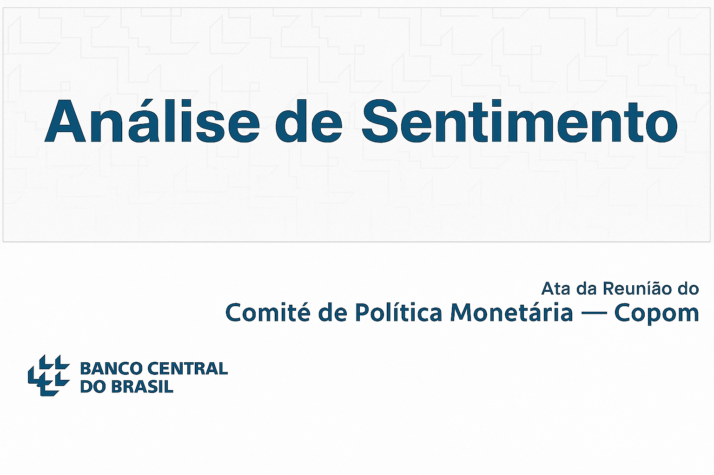
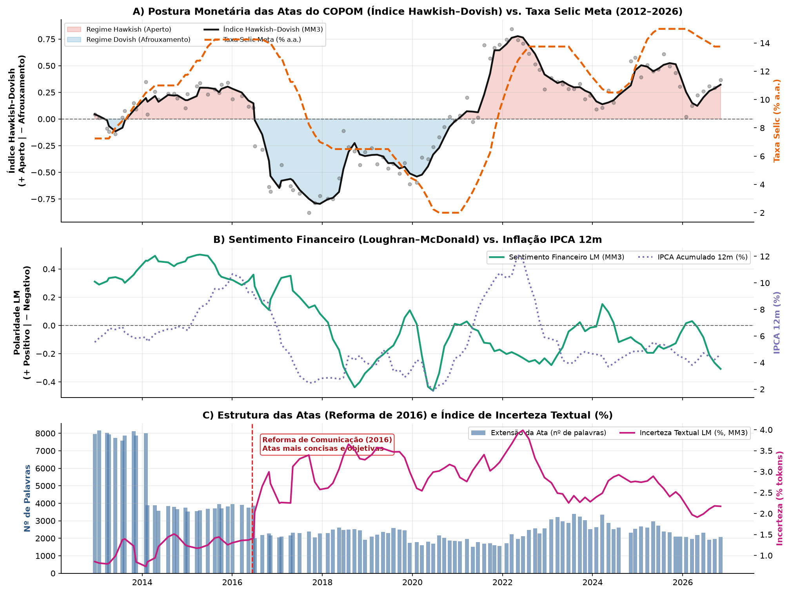
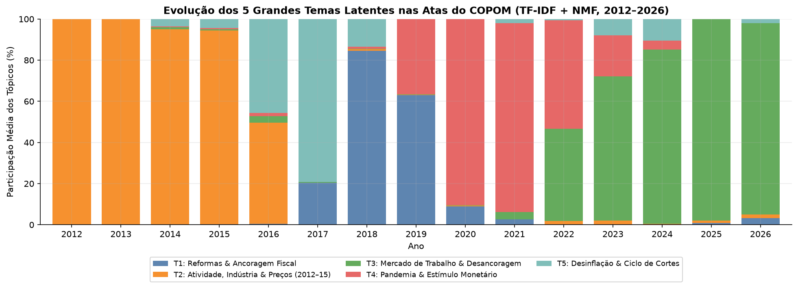
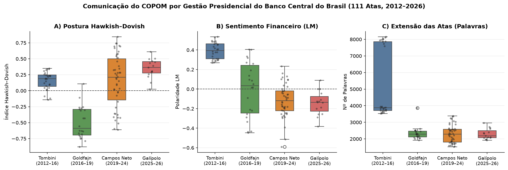

<p align="center">
  
</p>

# 🏦 Análise de Sentimento & Postura Monetária nas Atas do COPOM (2012–2026)

<div align="center">


-08519c?style=for-the-badge)

</div>

Projeto de **Processamento de Linguagem Natural (NLP)** e **Economia Monetária** aplicado a **111 atas oficiais do Comitê de Política Monetária (COPOM / Banco Central do Brasil)** — da **171ª Reunião (dezembro/2012)** até a **282ª Reunião (03–04 de novembro de 2026)** — integradas às séries oficiais da **Taxa Selic Meta (SGS 432)** e do **IPCA (SGS 433)**.

---

## 🎯 Por que este projeto vai além de "Positivo vs. Negativo"?

Em bancos centrais, uma economia forte gera linguagem "positiva" de atividade e, simultaneamente, sinaliza **alta de juros** (*aperto monetário*). Por isso, o módulo próprio [`src/copom_nlp.py`](./src/copom_nlp.py) combina **três camadas complementares de NLP** (100% reprodutíveis e sem dependências obsoletas):

1. **Sentimento Financeiro (estilo Loughran–McDonald)** + **Índice de Incerteza (%)**, com tratamento explícito de janela de negação (*"not", "no", "less"*).
2. **Índice *Hawkish–Dovish* (Postura de Política Monetária)**: léxico especializado em bancos centrais combinando unigramas e expressões/bigramas (*inflation expectations, core inflation, monetary tightening, upside risks* vs. *economic slack, monetary easing, disinflationary process, downside risks*).
3. **Descoberta Não-Supervisionada de Tópicos (TF-IDF + NMF)**: mapeia automaticamente os 5 grandes regimes temáticos que dominaram a agenda do COPOM nos últimos 14 anos.

---

## 📊 Principais Resultados Verificados (111 Reuniões: 2012–2026)

### 1. Postura *Hawkish–Dovish* vs. Sentimento Genérico (1 linha por reunião, sem duplicação)

| Métrica NLP | Selic Meta ($t$) | Decisão $\Delta\text{Selic}_t$ | Próxima Decisão $\Delta\text{Selic}_{t+1}$ | IPCA 12m |
| :--- | :---: | :---: | :---: | :---: |
| ⭐ **Índice *Hawkish–Dovish* (Política Monetária)** | **`+0,457***`** (`p<0,001`) | **`+0,473***`** (`p<0,001`) | **`+0,442***`** (`p<0,001`) | **`+0,537***`** (`p<0,001`) |
| **Sentimento Financeiro (Loughran–McDonald)** | `+0,221**` (`p=0,020`) | `-0,138` (`p=0,149`) | `-0,104` (`p=0,279`) | `+0,262***` (`p=0,005`) |
| **Índice de Incerteza Textual (%)** | `-0,305***` (`p=0,001`) | `+0,245***` (`p=0,010`) | `+0,211**` (`p=0,027`) | `-0,164*` (`p=0,085`) |

> **Achado central:** enquanto a polaridade genérica *Loughran–McDonald* não tem correlação estatisticamente significativa com a decisão seguinte da Selic (`p = 0,279`), o **Índice *Hawkish–Dovish*** apresenta forte correlação positiva com a decisão da próxima reunião (**`r = +0,442, p < 0,0001`**) e antecipa visualmente todas as grandes viradas de ciclo da Selic entre 2012 e 2026 (2016, 2021, 2023, 2024–2025 e a moderação/retomada de cautela em 2026).



---

### 2. Evolução dos 5 Tópicos Latentes (TF-IDF + NMF, 2012–2026)

A fatoração NMF reconstruiu automaticamente a história monetária recente do Brasil sem qualquer supervisão:
- **2012–2015** → *Atividade, Indústria & Preços*
- **2016–2017** → *Desinflação & Ciclo de Cortes*
- **2018–2019** → *Reformas & Ancoragem Fiscal*
- **2020–2021** → *Pandemia & Estímulo Monetário*
- **2022–2026** → *Mercado de Trabalho & Desancoragem de Expectativas*



---

### 3. Comunicação por Presidência do BCB (Kruskal–Wallis $p < 0{,}0001$ em todas as métricas)

| Presidência do BCB | Período | Reuniões | Palavras / Ata | *Hawkish* Médio | Sentimento LM | Selic Média | IPCA 12m Médio |
| :--- | :---: | :---: | :---: | :---: | :---: | :---: | :---: |
| **Alexandre Tombini** | 2012–2016 | `28` | `5.244` | `+0,159` | `+0,393` | `11,13%` | `7,33%` |
| **Ilan Goldfajn** | 2016–2019 | `22` | `2.341` | **`-0,497`** | `-0,005` | `9,59%` | `4,85%` |
| **Roberto Campos Neto** | 2019–2024 | `46` | `2.296` | `+0,154` | `-0,118` | `8,44%` | `5,66%` |
| **Gabriel Galípolo** | 2025–2026 | `15` | `2.292` | **`+0,350`** | `-0,144` | `14,48%` | `4,71%` |

- Na gestão **Gabriel Galípolo** (até a **282ª Reunião de 03–04/11/2026**), o índice capturou o pico contracionista em jul/2025 (`+0,61`, Selic `15,00%`), a moderação no início de 2026 (`+0,02` em jan/2026) antecedendo os cortes até `13,75%`, e a renovação da cautela em nov/2026 (`+0,365`, IPCA 12m em `4,63%`).
- Na validação temporal **Walk-Forward** (65 reuniões *out-of-sample*, `2018-08` a `2026-09`) prevendo **Corte / Manutenção / Alta** em $t+1$, o *baseline* macro atinge `80,0%` (`Macro-F1 = 0,802`) e o modelo integrado (`Macro + Índice Hawkish`) atinge `76,9%` (`Macro-F1 = 0,774`) com **zero inversões direcionais** — mostrando de forma transparente que a inércia de ciclo domina reuniões de continuidade, enquanto o NLP brilha no monitoramento de **pontos de inflexão e *forward guidance***.



---

## 📁 Estrutura do Projeto

```text
Analise_sentimento_COPOM/
├── data/
│   ├── atas_copom.csv.gz                      # Corpus completo de 111 atas oficiais (2012–2026)
│   ├── selic_diaria.csv                       # Histórico diário Selic Meta (SGS 432, até 25/11/2026)
│   └── macro_selic_ipca.csv                   # Selic mensal + IPCA mensal e 12m (SGS 433)
├── src/
│   └── copom_nlp.py                           # Motor modular NLP (LM, Hawkish-Dovish, NMF, BCB)
├── img/
│   ├── capa.png                               # Capa do projeto
│   ├── evolucao_hawkish_sentimento_selic.png  # Postura Hawkish vs Selic, LM vs IPCA e Reforma 2016
│   ├── top_expressoes_hawkish_dovish.png      # Top 10 expressões Hawkish vs Dovish
│   ├── topicos_nmf_copom_evolucao.png         # Evolução anual dos 5 tópicos NMF (2012–2026)
│   ├── correlacao_ccf_hawkish_selic.png       # CCF por defasagem e Forward Guidance (t vs t+1)
│   ├── walkforward_previsao_selic_nlp.png     # Validação temporal Walk-Forward + Matriz de Confusão
│   └── comparacao_presidencias_bcb.png        # Comparação entre as 4 gestões presidenciais do BCB
├── outputs/
│   └── copom_nlp_macro_panel.csv              # Painel analítico final (111 reuniões × NLP + Macro)
├── analise_sentimento_copom.ipynb             # Notebook principal 100% executável offline
├── analise_sentimento_copom.html              # Relatório HTML pronto para leitura no navegador
├── requirements.txt                           # Dependências Python enxutas
└── README.md
```

---

## 🚀 Como Reproduzir

```bash
cd Analise_sentimento_COPOM
pip install -r requirements.txt
jupyter lab analise_sentimento_copom.ipynb
```

Para leitura imediata sem executar código, abra [`analise_sentimento_copom.html`](./analise_sentimento_copom.html) diretamente no navegador.

---

## 👨‍💻 Autor

**Silvio da Rosa Paula** — Doutor em Economia Aplicada | Cientista de Dados  
[LinkedIn](https://www.linkedin.com/in/silvio-paula/) • [Portfólio Web](https://silviopaula.github.io/)
