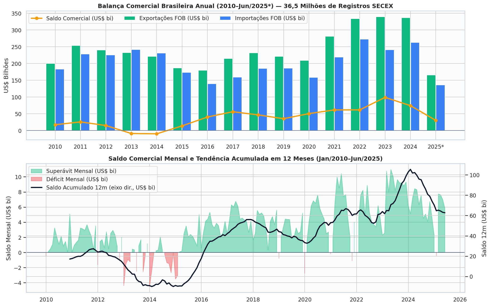
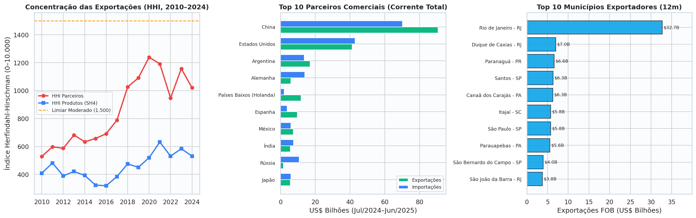
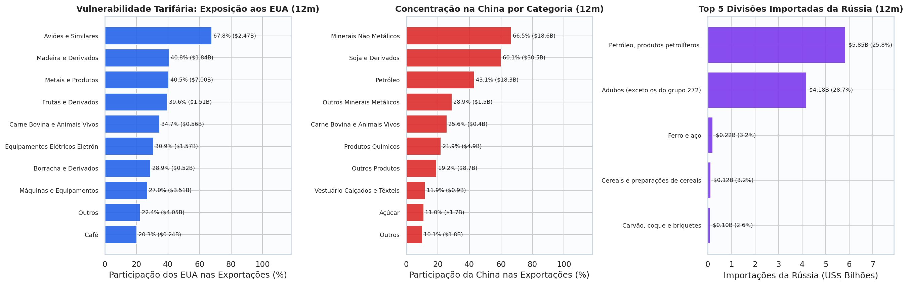
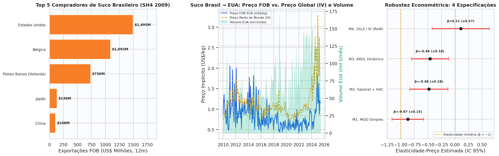
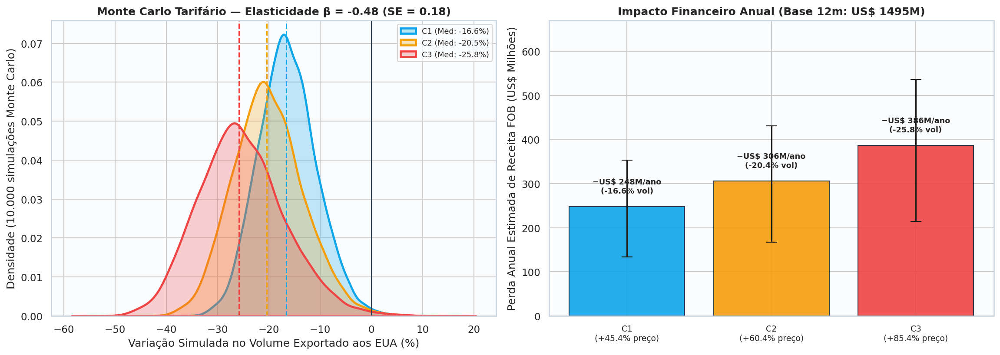
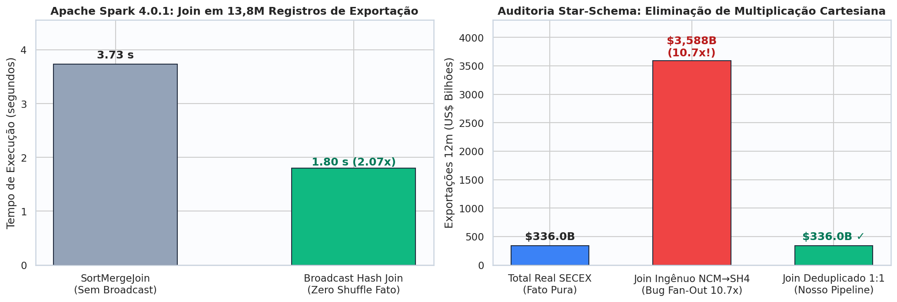

# 🚢 Comércio Exterior Brasileiro em Apache Spark 4.0 — Concentração Geoeconômica, Econometria & Simulação Tarifária

Análise distribuída de Big Data e Econometria de Comércio Internacional sobre **`36.481.316` registros municipais oficiais da SECEX/ComexStat (`2010–Jun/2025`, US\$ 7,09 trilhões acumulados)** utilizando **Apache Spark 4.0.1 (`PySpark`)**, **Adaptive Query Execution (AQE)**, **Broadcast Hash Joins**, **Índice de Concentração HHI**, **Econometria de Demanda (MQO, Newey-West HAC, ARDL Dinâmico e teste crítico 2SLS/IV)** e **Simulação Monte Carlo (10.000 cenários tarifários dos EUA)**.

> 📄 **Leitura Rápida (Relatório HTML Standalone):** abra [comercio_exterior_pyspark_tarifas.html](./comercio_exterior_pyspark_tarifas.html) diretamente no navegador (todas as figuras embutidas).

---

## 🎯 Principais Destaques de Engenharia & Econometria

### 1. Engenharia Big Data em Apache Spark 4.0.1 (`36,5M` linhas)
- **Auditoria Star-Schema & Eliminação de *Fan-Out* (`10,68×` → `1,00×` exato):** a tabela fato municipal da SECEX está no grão `SH4`, enquanto dicionários NCM/SH6 possuem `13.717` linhas para `1.455` códigos `SH4` únicos. Um join ingênuo sem deduplicação multiplicava as exportações de 12 meses de **US\$ 335,96 bi** para **US\$ 3.587,9 bi (`10,68×`)**. Nossa deduplicação 1:1 pela moda no grão `SH4` garante **100,00% de conservação do Valor FOB**.
- **Otimização Catalyst (`BroadcastHashJoin` vs. `SortMergeJoin`):** validado diretamente via `explain("formatted")` sobre os **`13.779.191`** registros de exportação, alcançando **`2,07×` de speedup** (`1,80 s` vs. `3,73 s`) com **zero shuffle** na tabela fato.

### 2. Concentração Geoeconômica & Vulnerabilidades Bilaterais (`2010–Jun/2025`)
- **Balança Comercial 2024:** Exportações de **US\$ 337,0 bi**, Importações de **US\$ 262,9 bi** e Superávit de **US\$ 74,2 bi** (corrente total de **US\$ 599,9 bi**).
- **Alta do Índice HHI (2010 → 2024):** o **HHI de Parceiros** quase dobrou (`529` → **`1.020`**), acompanhando o avanço da participação chinesa (`15,3%` → **`28,0%`**), enquanto o **HHI de Produtos (`SH4`)** subiu de `409` para **`531`**.
- **Assimetria EUA vs. China (Jul/2024–Jun/2025):**
  - **China** lidera a corrente total (**US\$ 160,6 bi**, superávit de **US\$ 20,4 bi**) concentrada em commodities (*Minerais Não Metálicos* `66,5%`, *Soja* `60,1%`, *Petróleo* `43,1%`).
  - **Estados Unidos** (**US\$ 84,1 bi** de corrente) absorvem a pauta de maior valor agregado e mais exposta a choques tarifários: *Aviões e Similares* (**`67,8%`**, US\$ 2,47 bi), *Madeira* (`40,8%`), *Metais* (`40,5%`, US\$ 7,00 bi) e *Frutas/Sucos* (`39,6%`, US\$ 1,51 bi).
  - **Rússia (Importações Críticas):** responde por **`28,7%`** das importações brasileiras de *Adubos/Fertilizantes* (US\$ 4,18 bi; alternativas: China, Marrocos, Canadá) e **`25,8%`** de *Derivados de Petróleo/Diesel* (US\$ 5,85 bi; alternativas: EUA, Arábia Saudita, Argélia).
  - **Polo Municipal:** **Rio de Janeiro – RJ** lidera as exportações municipais (**US\$ 32,7 bi**), seguido por Duque de Caxias – RJ (`US$ 7,0 bi`), Paranaguá – PR (`US$ 6,6 bi`), Santos – SP (`US$ 6,3 bi`) e Canaã dos Carajás – PA (`US$ 6,3 bi`).

### 3. Estudo de Caso: Elasticidade-Preço & Monte Carlo Tarifário do Suco de Laranja (Brasil → EUA)

Painel mensal de **186 meses (`2010–Jun/2025`, `SH4 2009`)**, base 12 meses de **US\$ 1.494,7 milhões** (`1.275,8 mil t`, preço FOB médio de **US\$ 1,172/kg**):

| Especificação Econométrica | Elasticidade ($\hat{\beta}$) | Erro-Padrão | p-valor | Diagnóstico |
| :--- | :---: | :---: | :---: | :--- |
| **M1: MQO Simples (Log-Log)** | `-0,8706` | `0,1492` | `0,0000` | Baseline sem controles sazonais/HAC (`R² = 0,156`) |
| ⭐ **M2: MQO + Sazonalidade + Tendência (HAC)** | **`-0,4818`** | `0,1808` | **`0,0077`** | **Especificação Principal** (Newey-West 6 lags, demanda inelástica) |
| **M3: ARDL(1,0) Dinâmico (HAC)** | `-0,4600` *(LP: `-0,430`)* | `0,1753` | `0,0087` | Confirma estabilidade entre curto e longo prazo ($\rho = -0,070$) |
| **M4: Teste Crítico 2SLS / IV (Preço RoW)** | `+0,1059` | `0,2688` | `0,6935` | 1º Estágio forte (`F = 42,0`), mas viola restrição de exclusão (choques na Flórida movem preço global) |

#### Simulação Monte Carlo (`10.000` sorteios com especificação principal `M2 HAC`)

| Cenário Tarifário (EUA) | Preço Efetivo (*Landed*) | Δ Preço | Δ Volume (Mediana) | Faixa P10–P90 | Impacto FOB Estimado |
| :--- | :---: | :---: | :---: | :---: | :---: |
| **C1: Tarifa Vigente (`10% + US$ 415/t`)** | `US$ 1,704/kg` | `+45,4%` | **`-16,6%`** | `[-23,6%, -8,9%]` | **`-US$ 247,9M/ano`** |
| **C2: Estresse Moderado (`25% + US$ 415/t`)** | `US$ 1,880/kg` | `+60,4%` | **`-20,4%`** | `[-28,8%, -11,2%]` | **`-US$ 305,7M/ano`** |
| **C3: Sobretaxa Extrema (`50% + US$ 415/t`)** | `US$ 2,173/kg` | `+85,4%` | **`-25,8%`** | `[-35,9%, -14,3%]` | **`-US$ 386,2M/ano`** |

---

## 🖼️ Galeria de Visualizações Geradas

| Balança Comercial Histórica (`2010–Jun/2025`) | Concentração HHI, Parceiros & Municípios |
| :---: | :---: |
|  |  |

| Exposição EUA vs. China & Importações da Rússia | Suco de Laranja: Mercados & 4 Elasticidades |
| :---: | :---: |
|  |  |

| Simulação Monte Carlo Tarifária (10.000 Sorteios) | Apache Spark 4.0: Broadcast & Auditoria Fan-Out |
| :---: | :---: |
|  |  |

---

## 🏗️ Estrutura do Projeto

```text
Comercio_exterior_spark_análise/
├── comercio_exterior_pyspark_tarifas.ipynb  # Notebook PySpark 4.0 completo e executado
├── comercio_exterior_pyspark_tarifas.html   # Relatório HTML standalone (figuras embutidas)
├── src/
│   ├── spark_comex_pipeline.py              # Motor PySpark 4.0 (AQE, Broadcast, HHI, Window)
│   ├── econometrics_tariffs.py              # MQO, HAC, ARDL, 2SLS-IV, Monte Carlo e 6 figuras
│   └── build_notebook.py                    # Construtor reprodutível do notebook analítico
├── tests/
│   └── test_comex_pipeline.py               # Suíte unitária (tarifa, HHI, 2SLS e Monte Carlo)
├── outputs/
│   ├── metrics_summary.json                 # Métricas completas auditadas
│   ├── balanca_anual_2010_2025.csv          # Série anual agregada
│   ├── hhi_concentracao_anual.csv           # Série anual HHI parceiros e produtos
│   ├── suco_laranja_eua_mensal.csv          # Painel mensal SH4 2009 EUA vs Resto do Mundo
│   └── figures/                             # 6 figuras executivas em alta resolução (PNG)
├── requirements.txt
└── README.md
```

*(Os arquivos brutos de 411 MB da SECEX/ComexStat em `data/` e `data.zip` são ignorados via `.gitignore` por limite de tamanho do GitHub; os artefatos agregados em `outputs/` permitem auditar e reproduzir toda a modelagem econométrica instantaneamente.)*

---

## 🚀 Como Reproduzir

```bash
cd Comercio_exterior_spark_análise
pip install -r requirements.txt

# 1. Rodar testes unitários (tarifas, HHI, 2SLS-IV e Monte Carlo)
python -m unittest discover -s tests -v

# 2. Executar pipeline completo Apache Spark 4.0 (36,5M linhas) + Econometria + Figuras
# Requer Java JDK 17/21 e os Parquets SECEX em data/ (ou data.zip)
python src/econometrics_tariffs.py

# 3. Gerar, executar o notebook e exportar o HTML standalone
python src/build_notebook.py
python -m jupyter nbconvert --to notebook --execute --inplace comercio_exterior_pyspark_tarifas.ipynb
python -m jupyter nbconvert --to html --embed-images comercio_exterior_pyspark_tarifas.ipynb --output comercio_exterior_pyspark_tarifas.html
```

---

## 🛠️ Stack Tecnológico

`Apache Spark 4.0 (PySpark)` • `Catalyst AQE & Broadcast Hash Join` • `Python` • `Statsmodels (HAC / ARDL / 2SLS)` • `Monte Carlo` • `Pandas` • `NumPy` • `SciPy` • `Matplotlib` • `Seaborn` • `Parquet`
