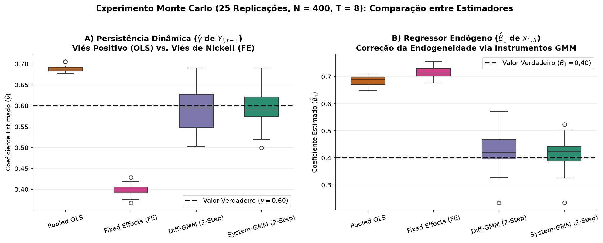
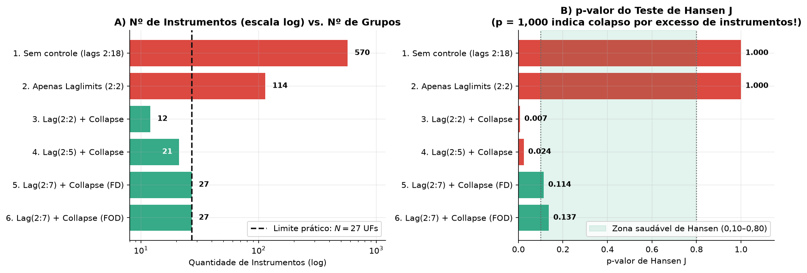
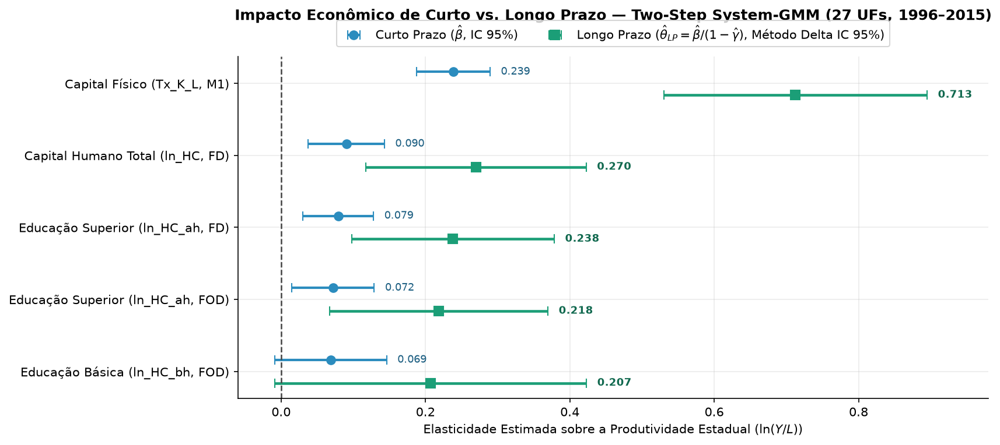

# 📊 Guia Prático de Painel Dinâmico & System-GMM em Python (e Referência Stata)

<div align="center">


</div>

Guia completo — **teórico, simulado (Monte Carlo) e empírico** — para estimação, diagnóstico e interpretação de modelos de **Painel Dinâmico** utilizando **Difference-GMM (Arellano & Bond, 1991)** e **Two-Step System-GMM (Blundell & Bond, 1998)** com correção de amostra finita de **Windmeijer (2005)** em **Python**, acompanhado de referência cruzada para o comando **`xtabond2`** do **Stata**.

A aplicação empírica utiliza a base real das **27 Unidades da Federação do Brasil (1996–2015)** do artigo publicado na *Revista Brasileira de Economia* (SciELO):

> Paula, S. R. et al. — [*Economic Growth Channels From Human Capital: A Dynamic Panel Analysis for Brazil*](https://www.scielo.br/j/rbe/a/KkYHXdsxP7nXzLRBCbY64Vq/?lang=en).

---

## 🎯 O que você encontrará neste projeto

1. **Fundamentação Econométrica Didática**:
   - Por que **Pooled OLS** enviesa o coeficiente autorregressivo $\hat{\gamma}$ para cima e **Efeitos Fixos (Within)** sofre do **Viés de Nickell (1981)** (viés para baixo).
   - **Intervalo de Bond (2002)** ($\hat{\gamma}_{\text{FE}} \le \hat{\gamma}_{\text{GMM}} \le \hat{\gamma}_{\text{OLS}}$), evolução Anderson–Hsiao → Diff-GMM → FOD → System-GMM e checklist completo de **Roodman (2009)** (`AR(1)`, `AR(2)`, `Hansen J` e regra `Instrumentos <= Grupos`).
2. **Laboratório Monte Carlo (25 Replicações, $N = 400, T = 8$)**:
   - Prova numérica e visual com parâmetros verdadeiros conhecidos demonstrando o viés do OLS, o Viés de Nickell no FE, a distorção da endogeneidade contemporânea e a consistência do **Two-Step System-GMM**.
3. **Aplicação Empírica Real (`data/BASE_CH.dta`, 27 UFs, 1996–2015)**:
   - Demonstração prática do **colapso do teste de Hansen (`p = 1,000`)** sob proliferação de instrumentos (`570` instrumentos sem controle vs. `26–27` com `laglimits + collapse`).
   - Estimação dos canais de **Capital Humano Total (`ln_HC`)**, **Educação Superior (`ln_HC_ah`)**, **Educação Básica (`ln_HC_bh`)** e **Taxa de Acumulação (`Tx_HC`)** em Primeira Diferença (FD) e Desvios Ortogonais (FOD).
   - **Efeitos de Longo Prazo ($\theta_{\text{LP}} = \frac{\hat{\beta}}{1 - \hat{\gamma}}$) via Método Delta** utilizando a matriz de covariância Windmeijer exata do `pydynpd` (equivalente em Python ao comando `nlcom` do Stata), além da velocidade de convergência e meia-vida.
4. **Validação Cruzada (`pydynpd` vs. `xtabond2`) & Curva de Especificação (*Specification Curve*)**:
   - Comparação direta coeficiente a coeficiente entre Python e Stata, mais grade controlada de **72 especificações** destacando os **24 modelos aprovados em todos os testes de Roodman**.
5. **Compatibilidade garantida com NumPy 2.x (Python 3.12–3.14)**: inclui *shim* limpo de compatibilidade para o alias legado `np.NaN` usado pelo `pydynpd`.

---

## 📊 Principais Resultados Verificados

### 1. Experimento Monte Carlo (25 Replicações, $N=400, T=8$)

| Estimador | $\hat{\gamma}$ ($Y_{i,t-1}$, real `0,600`) | Viés em $\hat{\gamma}$ | $\hat{\beta}_1$ ($x_1$ endógeno, real `0,400`) | Viés em $\hat{\beta}_1$ | $\hat{\beta}_2$ (real `0,300`) | $\hat{\beta}_3$ (real `0,250`) | $\hat{\delta}$ ($z$ exóg., real `0,200`) |
| :--- | :---: | :---: | :---: | :---: | :---: | :---: | :---: |
| **Pooled OLS** | `0,688` | `+0,088` | `0,686` | `+0,286` | `0,541` | `0,314` | `0,209` |
| **Fixed Effects (FE)** | `0,398` | **`-0,202`** *(Nickell)* | `0,716` | `+0,316` | `0,551` | `0,257` | `0,192` |
| **Diff-GMM (2-Step)** | `0,590` | `-0,010` | `0,421` | `+0,021` | `0,328` | `0,240` | `0,206` |
| ⭐ **System-GMM (2-Step)** | **`0,594`** | **`-0,006`** | **`0,419`** | **`+0,019`** | **`0,330`** | **`0,241`** | **`0,208`** |



---

### 2. Proliferação de Instrumentos na Base Real (27 UFs, 1996–2015)

| Especificação (`Tx_HC`) | Nº Instrumentos | AR(1) *p* | AR(2) *p* | Hansen J *p* | Diagnóstico Roodman (2009) |
| :--- | :---: | :---: | :---: | :---: | :--- |
| Sem controle (`lags 2:18`) | **`570`** | `0,000` | `0,548` | **`1,000`** | Proliferado (`Inst > 27` → colapso do Hansen) |
| Apenas Laglimits (`2:2`) | **`114`** | `0,000` | `0,499` | **`1,000`** | Proliferado (`Inst > 27` → colapso do Hansen) |
| Lag (`2:2`) + Collapse | `12` | `0,001` | `0,692` | `0,007` | Rejeita sobreidentificação (`p < 0,10`) |
| ⭐ **Lag (`2:7`) + Collapse (FD)** | **`27`** | **`0,000`** | **`0,446`** | **`0,114`** | **Aprovado** (`Inst <= 27`, zona saudável) |



---

### 3. Canais do Capital Humano e Efeitos de Longo Prazo (Método Delta — Windmeijer)

| Modelo (Two-Step System-GMM, `lag 2:7 + collapse`) | Inst. | $\hat{\gamma}$ (`L1.lnY_L`) | Curto Prazo ($\hat{\beta}$) | Longo Prazo ($\hat{\theta}_{\text{LP}}$) | SE Delta (LP) | *p* (LP) | Meia-Vida | AR(2) *p* | Hansen *p* |
| :--- | :---: | :---: | :---: | :---: | :---: | :---: | :---: | :---: | :---: |
| **M1: Capital Humano Total (`ln_HC`, FD)** | `26` | `0,6653` | **`+0,0904`** (`p=0,001`) | **`+0,2700`** | `0,0779` | **`0,0005`** | `1,70 anos` | `0,687` | `0,107` |
| **M2: Educação Superior (`ln_HC_ah`, FD)** | `26` | `0,6679` | **`+0,0791`** (`p=0,002`) | **`+0,2382`** | `0,0716` | **`0,0009`** | `1,72 anos` | `0,745` | `0,110` |
| **M3: Educação Superior (`ln_HC_ah`, FOD)** | `26` | `0,6713` | **`+0,0718`** (`p=0,014`) | **`+0,2183`** | `0,0772` | **`0,0047`** | `1,74 anos` | `0,743` | `0,102` |
| **M4: Educação Básica (`ln_HC_bh`, FOD)** | `26` | `0,6695` | `+0,0685` (`p=0,084`) | `+0,2073` | `0,1101` | `0,0596` | `1,73 anos` | `0,569` | `0,113` |
| **M5: Taxa Acumulação CH (`Tx_HC`, FD)** | `27` | `0,6934` | **`+0,0700`** (`p=0,020`) | **`+0,2283`** | `0,1041` | **`0,0283`** | `1,89 anos` | `0,446` | `0,114` |

> **Destaque econômico:** alinhado a **Nelson & Phelps (1966)**, o **Capital Humano Superior (`ln_HC_ah`)** apresenta impacto positivo, forte e consistente tanto em FD quanto em FOD, com efeito multiplicador de longo prazo de **~3x** o impacto contemporâneo (`+0,22` a `+0,24`). Na **Curva de Especificação** (72 especificações avaliadas), **92% (22/24)** das especificações aprovadas em todos os diagnósticos de Roodman confirmam efeito positivo (medianas `+0,055` para Total e `+0,053` para Superior).



---

## 📁 Estrutura do Projeto

```text
Painel_Dinamico_GMM/
├── data/
│   └── BASE_CH.dta                           # Base empírica real (27 UFs do Brasil, 1996–2015)
├── img/
│   ├── monte_carlo_vies_nickell_gmm.png      # Prova Monte Carlo (OLS vs. FE vs. Diff/System-GMM)
│   ├── eda_painel_estados_brasil.png         # EDA do painel brasileiro (1996–2015)
│   ├── proliferacao_instrumentos_hansen.png  # Colapso do teste de Hansen por excesso de instrumentos
│   ├── efeitos_curto_vs_longo_prazo.png      # Elasticidades CP vs. LP (Método Delta, IC 95%)
│   └── curva_especificacao_robustez.png      # Specification Curve sobre 72 especificações
├── stata/
│   └── xtabond2_referencia.do                # Script Stata de referência (Tabelas 3–7 do artigo)
├── painel_dinamico_system_gmm.ipynb          # Notebook principal didático e 100% executável em Python
├── painel_dinamico_system_gmm.html           # Versão HTML renderizada para leitura direta no navegador
├── requirements.txt                          # Dependências Python
└── README.md
```

---

## 🚀 Como Reproduzir

```bash
cd Painel_Dinamico_GMM
pip install -r requirements.txt
jupyter lab painel_dinamico_system_gmm.ipynb
```

Para leitura imediata sem executar código, basta abrir [`painel_dinamico_system_gmm.html`](./painel_dinamico_system_gmm.html) diretamente no navegador.

---

## 👨‍💻 Autor

**Silvio da Rosa Paula** — Doutor em Economia Aplicada | Cientista de Dados  
[LinkedIn](https://www.linkedin.com/in/silvio-paula/) • [Portfólio Web](https://silviopaula.github.io/)
