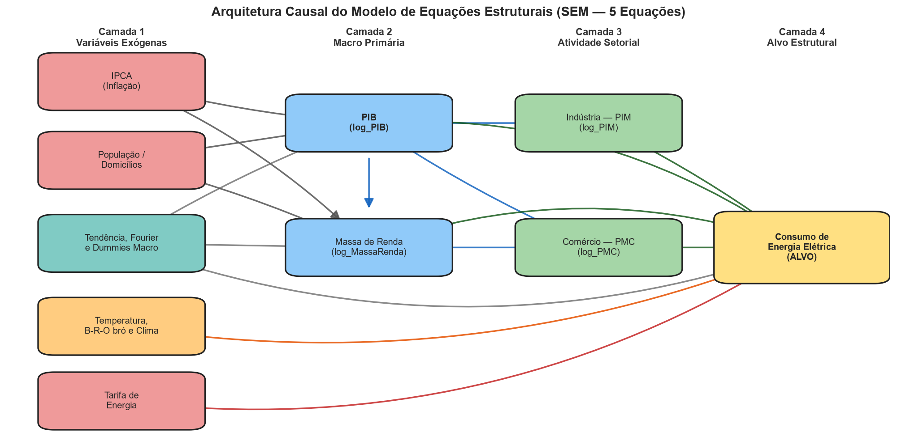
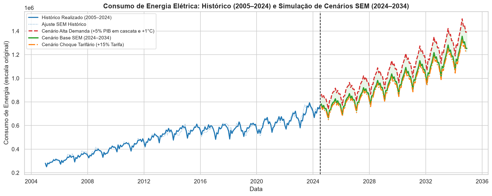

# ⚡ Modelagem de Equações Estruturais (SEM) para Projeção de Consumo de Energia e Simulação de Cenários

<div align="center">


**Sistema de 5 equações estruturais simultâneas (SUR/MLE) integrando macroeconomia, clima e tarifas para decomposição causal (efeitos diretos vs. indiretos), validação *out-of-sample* e projeção de longo prazo (2024–2034)**

</div>

---

## 📋 Sumário

- [Sobre o Projeto](#-sobre-o-projeto)
- [Arquitetura Causal (Diagrama SEM)](#-arquitetura-causal-diagrama-sem)
- [Decomposição Causal e Elasticidades](#-decomposição-causal-e-elasticidades)
- [Validação Out-of-Sample (SEM vs. Holt-Winters)](#-validação-out-of-sample-sem-vs-holt-winters)
- [Simulação de Cenários até 2034](#-simulação-de-cenários-até-2034)
- [Estrutura do Projeto](#-estrutura-do-projeto)
- [Como Executar](#-como-executar)
- [Autor](#-autor)

---

## 🎯 Sobre o Projeto

Enquanto modelos puramente autoregressivos (ARIMA, Holt-Winters) projetam a demanda olhando apenas para o histórico da própria série de energia, a **Modelagem de Equações Estruturais (*Structural Equation Modeling* — SEM)** estima simultaneamente um sistema hierárquico ligando **fundamentos macroeconômicos** (`PIB`, `Massa de Renda`, `PIM`, `PMC`, `IPCA`, `População`), **variáveis climáticas** (`Temperatura`, `B-R-O bró`, extremos térmicos) e **tarifas de energia** ao **Consumo de Energia Elétrica**.

O estudo utiliza **360 meses de dados (Jan/2005 a Dez/2034)** — sendo **235 meses observados** (`Jan/2005` a `Jul/2024`) e **125 meses de horizonte futuro** (`Ago/2024` a `Dez/2034`) — estimado em Python via **SUR iterado (*Seemingly Unrelated Regressions* / MLE)** no pacote `linearmodels`.

---

## 🕸️ Arquitetura Causal (Diagrama SEM)

<p align="center">
  
</p>

### Qualidade de Ajuste das 5 Equações Simultâneas (`235` meses observados)

| Equação Estrutural | Variável Endógena | $R^2$ |
| :--- | :--- | :---: |
| **1. Macro Primária** | `log_PIB` | `0,9291` |
| **2. Renda** | `log_MassaRenda` | `0,9559` |
| **3. Indústria** | `log_PIM` | `0,7573` |
| **4. Comércio** | `log_PMC` | `0,8736` |
| **5. Demanda Elétrica (Alvo)** | **`log_ConsumoEnergia`** | **`0,9855`** |

---

## 🔍 Decomposição Causal e Elasticidades

Por estar em formato **log-log**, o SEM permite decompor exatamente quanto de um choque de **`+1%` no PIB** chega ao consumo de energia de forma **direta** e quanto se propaga **indiretamente** pelos setores produtivo e comercial:

| Canal Causal (Choque de `+1%` no PIB) | Elasticidade (% Energia) | Participação no Total |
| :--- | :---: | :---: |
| **1. Efeito Direto** ($\text{PIB} \rightarrow \text{Energia}$) | **`+0,7968%`** | `60,1%` |
| **2. Indireto via Comércio** ($\text{PIB} \rightarrow \text{PMC} \rightarrow \text{Energia}$) | `+0,4120%` | `31,1%` |
| **3. Indireto Duplo** ($\text{PIB} \rightarrow \text{Renda} \rightarrow \text{PMC} \rightarrow \text{Energia}$) | `+0,0592%` | `4,5%` |
| **4. Indireto via Indústria** ($\text{PIB} \rightarrow \text{PIM} \rightarrow \text{Energia}$) | `+0,0556%` | `4,2%` |
| **5. Indireto via Renda Direta** ($\text{PIB} \rightarrow \text{Renda} \rightarrow \text{Energia}$) | `+0,0030%` | `0,2%` |
| **TOTAL INDIRETO (Soma dos Canais Setoriais)** | **`+0,5299%`** | **`39,9%`** |
| **EFEITO TOTAL (Direto + Indireto)** | **`+1,3267%`** | **`100,0%`** |

### Outras Elasticidades Estruturais Críticas ($p < 0,001$)
- **Elasticidade-Temperatura**: **`+1,1023%`** (alta sensibilidade térmica da demanda elétrica).
- **Elasticidade-Preço (Tarifa de Energia)**: **`-0,1693%`** (confirma demanda fortemente inelástica a preço no curto/médio prazo).

---

## 📈 Validação *Out-of-Sample* (SEM vs. Holt-Winters)

Treinando os modelos estritamente até **Jul/2023 (`223` meses)** e avaliando nos **12 meses reais nunca vistos (`Ago/2023` – `Jul/2024`)**:

| Posição | Modelo (*Backtest Out-of-Sample* — 12 Meses) | MAPE (%) | MAE | RMSE | $R^2$ |
| :---: | :--- | :---: | :---: | :---: | :---: |
| 🥇 | **SEM — Equações Estruturais (`SUR`)** | **`1,82%`** | **`13.286,5`** | **`15.315,9`** | **`0,7750`** |
| 🥈 | **Holt-Winters Multiplicativo (`ETS`)** | `4,40%` | `32.473,0` | `32.992,8` | `-0,0440` |
| 🥉 | **Seasonal Naive ($t - 12$)** | `9,42%` | `69.462,8` | `70.818,4` | `-3,8101` |

> **Destaque**: Ao incorporar clima, tarifas e atividade macroeconômica, o **SEM reduziu o MAPE fora da amostra em `58,6%`** frente ao Holt-Winters clássico (`1,82%` vs. `4,40%`).

---

## 🔮 Simulação de Cenários até 2034

Propagando choques estruturais em cascata através das 5 equações do SEM sobre os **125 meses futuros (`Ago/2024` – `Dez/2034`)**:

<p align="center">
  
</p>

| Ano-Marco | Cenário Base (Média Mensal) | Alta Demanda (`+5% PIB` cascata e `+1°C`) | Choque Tarifário (`+15% Tarifa`) | Desvio Alta vs. Base | Desvio Tarifa vs. Base |
| :---: | :---: | :---: | :---: | :---: | :---: |
| **2025** | `766.560` | `850.976` | `748.633` | **`+11,01%`** | **`-2,34%`** |
| **2027** | `847.196` | `940.479` | `827.383` | **`+11,01%`** | **`-2,34%`** |
| **2030** | `997.160` | `1.106.964` | `973.839` | **`+11,01%`** | **`-2,34%`** |
| **2034** | `1.228.259` | `1.363.506` | `1.199.534` | **`+11,01%`** | **`-2,34%`** |

---

## 📁 Estrutura do Projeto

```text
SEM-energy-forecasting/
├── data/
│   └── Dados.xlsx                          # Série mensal (360 meses: 2005–2034)
├── img/
│   ├── diagrama_sem.png                    # Diagrama causal (DAG) em 4 camadas
│   └── projecao_sem_cenarios.png           # Gráfico histórico + simulação de 3 cenários
├── outputs/
│   └── projecao_cenarios_sem_2034.csv      # Projeções mensais (2024–2034) nos 3 cenários
├── sem_energy_forecasting.ipynb            # Notebook completo e didático em Python (executado)
├── sem_energy_forecasting.html             # Versão renderizada em HTML para leitura rápida
├── requirements.txt                        # Dependências Python limpas
└── README.md                               # Documentação executiva do projeto
```

---

## 🚀 Como Executar

1. **Acesse a pasta e instale as dependências:**
   ```bash
   cd SEM-energy-forecasting
   pip install -r requirements.txt
   ```
2. **Abra e execute o notebook:**
   ```bash
   jupyter notebook sem_energy_forecasting.ipynb
   ```

---

## 👤 Autor

**Silvio da Rosa Paula**  
*Doutor em Economia Aplicada (UFPel) | Especialista em Inteligência Artificial e Ciência de Dados*

[](https://www.linkedin.com/in/silvio-paula/)
[](https://github.com/silviopaula)
[](mailto:silvio.rosa.paula@gmail.com)
