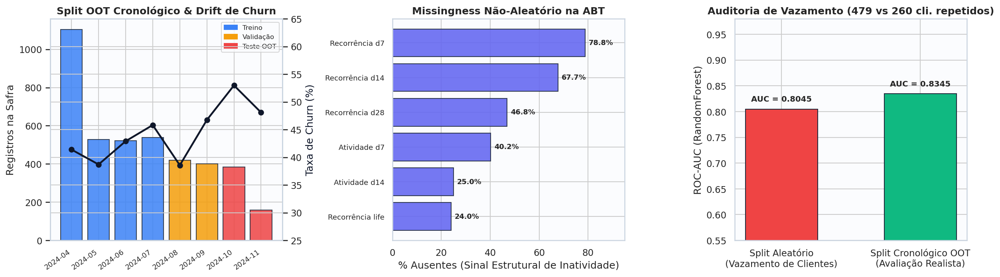
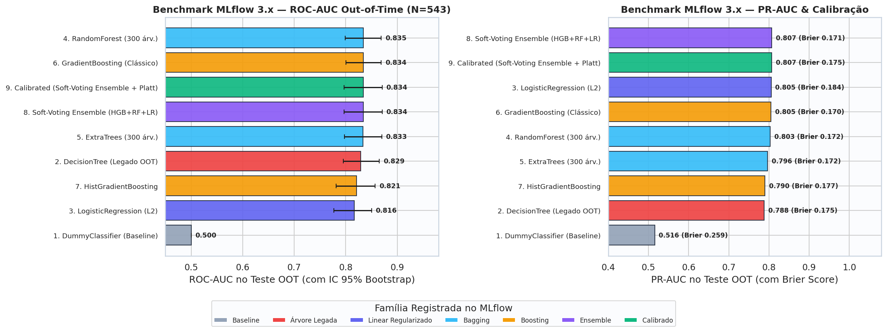
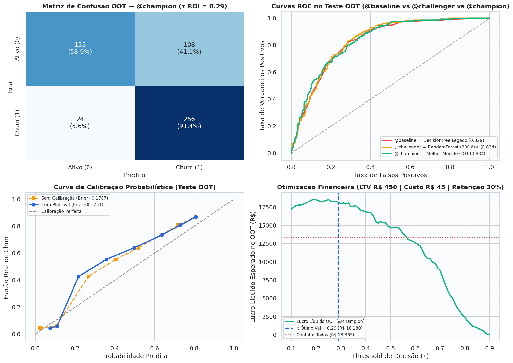
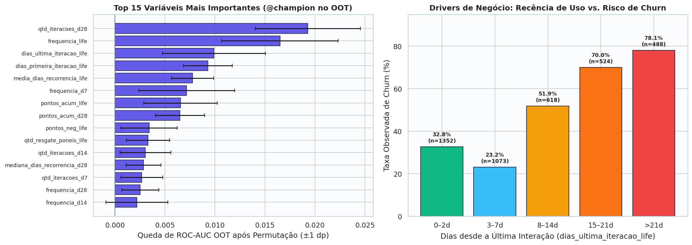
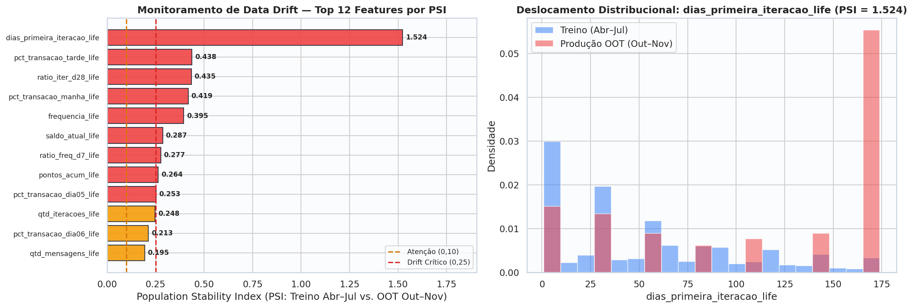
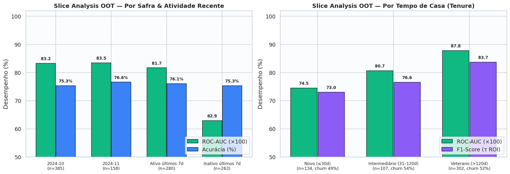

# 🚀 MLOps End-to-End com MLflow 3.3 — Previsão de Churn Out-of-Time

<div align="center">


</div>

Pipeline completo de **MLOps em produção** com **MLflow 3.3.1** (SQLite Tracking Store portátil + **Model Registry** + **Aliases `@baseline` / `@challenger` / `@champion`** + **Quality Gate automatizado**) aplicado à previsão de **churn** em uma base temporal real de **`4.055` registros (`1.506` clientes únicos, `92` variáveis comportamentais em 4 janelas `d7 / d14 / d28 / life`, Abr–Nov/2024)**.

---

## 📄 Relatórios Prontos para Leitura

- 📓 **Notebook Executado (conectado ao MLflow 3.3.1):** [`mlops_churn_mlflow.ipynb`](./mlops_churn_mlflow.ipynb) *(19 células executadas, 0 erros)*
- 🌐 **Relatório HTML Standalone (com gráficos embutidos):** [`mlops_churn_mlflow.html`](./mlops_churn_mlflow.html)

---

## 🎯 Diferenciais de Engenharia MLOps vs. Pipeline Legado

1. **Split Cronológico Out-of-Time (OOT) Estrito:** substituiu o `train_test_split` aleatório do notebook antigo (que misturava `479` clientes repetidos entre safras futuras e passadas) por particionamento temporal real: **Treino (`Abr–Jul/2024`, `2.692` linhas)**, **Validação (`Ago–Set/2024`, `820` linhas)** e **Teste Cego OOT (`Out–Nov/2024`, `543` linhas, onde a taxa de churn sobe de `42,1%` para `51,6%`)**.
2. **Zero *Training-Serving Skew* Comprovado (`1,11 × 10⁻¹⁶`):** encapsulamento do transformador customizado `ChurnFeatureEngineer` (indicadores de inatividade estrutural `d7/d14`, razões comportamentais e medianas congeladas no `fit()`) diretamente no artefato salvo no MLflow Registry — o modelo recebe o `DataFrame` bruto com `NaN`s diretamente em produção!
3. **Governança Automatizada no MLflow Model Registry (`churn-predictor`):**
   - `v1 (@baseline)`: `2. DecisionTree (Legado OOT)` (`Val AUC 0,7804` | `OOT AUC 0,8287`)
   - `v2 (@challenger)`: `4. RandomForest (300 árv.)` (`Val AUC 0,8031` | `OOT AUC 0,8345`)
   - `v3 (@champion)`: **`8. Soft-Voting Ensemble (HGB+RF+LR)`** (`Val AUC 0,8037` | `OOT AUC 0,8339` | **Maior `PR-AUC 0,8069`** | `Brier 0,1707`)
   - **Quality Gate Automático (`APROVADO`):** valida ganho `≥ +2 p.p.` na Validação sobre o legado, não-regressão + `Brier ≤ 0,20` no OOT, inferência via `models:/churn-predictor@champion` com erro `< 1e-9` e registro de auditoria de drift.
4. **Monitoramento de Data Drift (PSI) & Otimização Financeira (ROI):**
   - **PSI (Treino vs. OOT):** identificou `9` features com `PSI > 0,25`, lideradas pelo envelhecimento natural de `dias_primeira_iteracao_life` (`PSI = 1,524`), embasando política de retreino em janela deslizante.
   - **ROI da Campanha de Retenção** (`LTV = R$ 450`, `Custo = R$ 45`, `Retenção = 30%`): otimizar o corte na Validação (`τ = 0,29`, breakeven teórico `0,333`) gera no Teste OOT **Lucro Líquido de `R$ 18.180,00`** (`ROI = 111,0%`, `Recall = 91,4%`, `F1 = 0,7950`, `Acc = 75,7%`) — **`+R$ 4.815,00` (`+36,0%`)** acima de abordar toda a base (`R$ 13.365`) e **`+R$ 3.510,00`** acima do corte padrão `τ = 0,50` (`R$ 14.670`).

---

## 📊 Benchmark dos 9 Pipelines Rastreados no MLflow 3.3.1 (Teste OOT `N = 543`)

| Pipeline Rastreado | Família | Val AUC | OOT ROC-AUC (IC 95%) | OOT PR-AUC | OOT Brier | Alias Registry |
| :--- | :--- | :---: | :---: | :---: | :---: | :---: |
| **8. Soft-Voting Ensemble (HGB+RF+LR)** | **Ensemble** | **`0,8037`** | **`0,8339`** `[0,7964; 0,8706]` | **`0,8069`** | **`0,1707`** | 🏆 **`@champion` (v3)** |
| 4. RandomForest (300 árv.) | Bagging | `0,8031` | `0,8345` `[0,7993; 0,8686]` | `0,8032` | `0,1718` | 🥈 `@challenger` (v2) |
| 6. GradientBoosting (Clássico) | Boosting | `0,8028` | `0,8344` `[0,8009; 0,8690]` | `0,8052` | `0,1696` | — |
| 9. Calibrated (Soft-Voting + Platt) | Calibrado | `0,8037` | `0,8339` `[0,7964; 0,8706]` | `0,8069` | `0,1751` | — |
| 5. ExtraTrees (300 árv.) | Bagging | `0,8007` | `0,8334` `[0,7973; 0,8699]` | `0,7964` | `0,1724` | — |
| 2. DecisionTree (Legado OOT) | Árvore Legada | `0,7804` | `0,8287` `[0,7953; 0,8650]` | `0,7883` | `0,1753` | 📌 `@baseline` (v1) |
| 7. HistGradientBoosting | Boosting | `0,7864` | `0,8209` `[0,7814; 0,8569]` | `0,7900` | `0,1769` | — |
| 3. LogisticRegression (L2) | Linear | `0,7955` | `0,8163` `[0,7771; 0,8499]` | `0,8053` | `0,1840` | — |
| 1. DummyClassifier (Baseline) | Baseline | `0,5000` | `0,5000` `[0,5000; 0,5000]` | `0,5157` | `0,2588` | — |

---

## 🖼️ Galeria Executiva

| Coortes OOT, Missingness & Auditoria de Vazamento | Benchmark dos 9 Pipelines no MLflow 3.3 |
| :---: | :---: |
|  |  |

| Diagnóstico, Calibração & Curva de ROI (`τ = 0,29`) | Permutation Importance & Drivers de Recência |
| :---: | :---: |
|  |  |

| Monitoramento de Data Drift (PSI: Treino vs. OOT) | Slice-Based Error Analysis (Safra, d7 & Tenure) |
| :---: | :---: |
|  |  |

---

## 🏗️ Arquitetura do Projeto

```text
aplicacao_mlflow/
├── data/
│   └── abt.csv                             # ABT comportamental de churn (4.055 linhas × 95 colunas)
├── outputs/
│   ├── figures/                            # 6 figuras analíticas em alta resolução (PNG)
│   └── metrics_summary.json                # Métricas OOT, IC 95%, Registry, PSI, ROI e Slices
├── src/
│   ├── __init__.py
│   ├── churn_mlops.py                      # Pipeline completo MLflow 3.x + Registry + Drift PSI + ROI
│   ├── serve_predict.py                    # Inferência em lote via `models:/churn-predictor@champion`
│   ├── launch_mlflow_ui.py                 # Inicializador portátil da interface oficial MLflow UI
│   └── build_notebook.py                   # Construtor do notebook executável a partir das métricas auditadas
├── tests/
│   └── test_mlops_pipeline.py              # 5 testes unitários (OOT, Zero Skew, PSI, ROI, MLflow Registry)
├── mlops_churn_mlflow.ipynb                # Notebook Jupyter executado (19 células, 0 erros)
├── mlops_churn_mlflow.html                 # Relatório HTML standalone com gráficos embutidos
├── requirements.txt
└── README.md
```

---

## 🚀 Como Reproduzir Localmente

```bash
# 1. Instalar dependências (Python com MLflow 3.x)
pip install -r requirements.txt

# 2. Rodar suíte de testes unitários (5/5 OK, incluindo teste de Zero Training-Serving Skew)
python -m unittest discover -s tests -v

# 3. Executar o ciclo MLOps completo (popula `mlflow_store/mlflow.db`, Registry e 6 figuras)
python src/churn_mlops.py

# 4. Consumir o modelo em produção direto do Registry pelo alias `@champion`
python src/serve_predict.py --alias champion --threshold 0.29

# 5. Abrir a interface web oficial do MLflow UI (http://127.0.0.1:5000)
python src/launch_mlflow_ui.py
```
