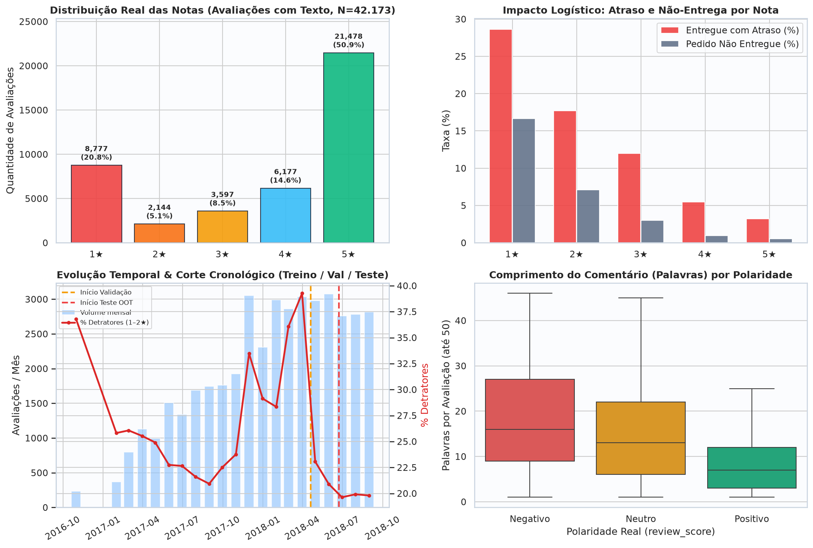
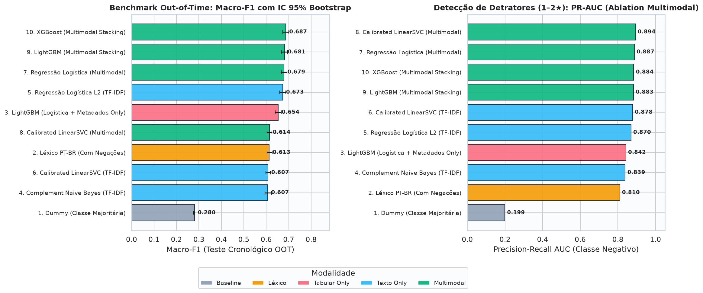
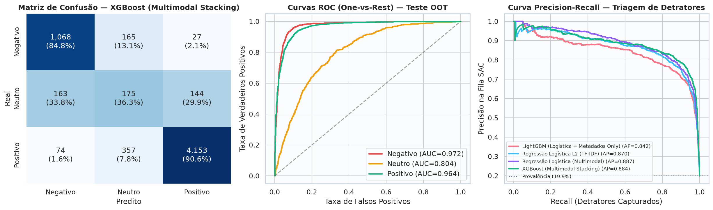
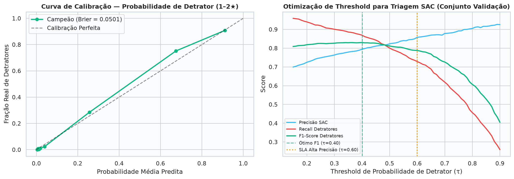
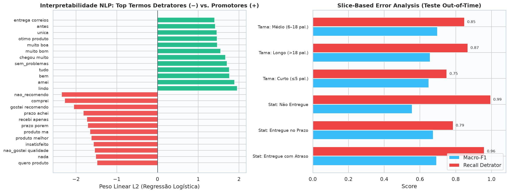
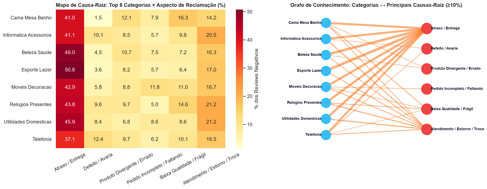

# 🛒 NLP & Inteligência de Experiência do Cliente — E-Commerce Brasil (Olist)

Pipeline *end-to-end* de **Processamento de Linguagem Natural em Português (PT-BR)**, **Modelagem Multimodal (Texto + Logística)**, **Mineração de Causa-Raiz por Aspecto (ABSA + NMF + Grafo NetworkX)** e **Copiloto RAG de Atendimento (Zero Alucinação)** sobre a base oficial **Olist Brazilian E-Commerce** (`98.673` pedidos avaliados únicos | `42.173` avaliações escritas).

---

## 🎯 Problema de Negócio & Diferenciais Metodológicos

Em marketplaces de grande escala, milhares de avaliações chegam diariamente em português informal (abreviações, erros de digitação, reclamações compostas). Este projeto resolve três desafios críticos para **CX, SAC e Operações**:

1. **Classificação de Polaridade Real & Triagem de Detratores (`1–2★`)** com split **cronológico estrito** (*Out-of-Time*) e **zero vazamento de dados**.
2. **Mineração de Causa-Raiz Acionável (ABSA + NMF + Grafo NetworkX)** mapeando quais falhas operacionais predominam em cada categoria de produto.
3. **Copiloto RAG Determinístico de SAC** que recupera casos históricos similares por cosseno TF-IDF, incorpora contexto factual do pedido (atraso, categoria, valor) e gera resposta empática em **~18 ms** sem custo de GPU.

### Boas Práticas Aplicadas
- **Targets Reais (Zero Circularidade):** Treinamento e avaliação sobre a **nota real do cliente (`review_score 1–5`)** — jamais sobre rótulos sintéticos de léxicos.
- **Eliminação de *Group Leakage* (`m:m`):** Agregação prévia dos itens no grão `order_id` antes do cruzamento com `reviews` (`98.673` pedidos únicos).
- **Preservação de Valores Ausentes Informativos:** Pedidos sem data de entrega (`2,88%`) apresentam taxa de detratores de **84,4%** — preservados via indicador explícito `pedido_nao_entregue` + `MissingIndicator`.
- **Preservação de Negações em PT-BR (`+2,03 p.p.` Macro-F1):** Criação de bigramas explícitos de negação (`nao_recebi`, `nao_recomendo`, `nao_gostei`, `sem_problemas`) combinados com **TF-IDF Palavras (1–2) + Subpalavras (`char_wb` 3–5)**.

---

## 📊 Principais Resultados (Teste Cronológico Out-of-Time, `N = 6.326`)

Divisão temporal estrita: **Treino (`29.521`, até `2018-04-19`)** → **Validação (`6.326`, até `2018-06-22`)** → **Teste OOT (`6.326`, até `2018-10-17`)**.

### 1. Sinal Logístico (42.173 Avaliações Escritas)
- **Taxa de Atraso na Entrega:** `3,72%` em Positivos (`4–5★`) → `11,95%` em Neutros (`3★`) → **`26,49%` em Negativos (`1–2★`)** (**7,1× maior**).
- **Pedidos Não Entregues:** `0,61%` em Positivos → **`14,79%` em Negativos** (**24× maior**).

### 2. Benchmark de 10 Modelos & Ablation Multimodal

| Modelo | Modalidade | Macro-F1 (IC 95% Bootstrap) | Acurácia | F1 Detrator | PR-AUC Detr. | ROC-AUC Detr. | Latência (ms/1k) |
| :--- | :---: | :---: | :---: | :---: | :---: | :---: | :---: |
| 🏆 **XGBoost (Multimodal Stacking)** | **Multimodal** | **`0,6873`** `[0,674–0,701]` | `85,30%` | `0,8327` | `0,8838` | **`0,9718`** | `2,33 ms` |
| **LightGBM (Multimodal Stacking)** | **Multimodal** | `0,6809` `[0,667–0,695]` | `85,71%` | `0,8319` | `0,8828` | `0,9717` | `8,32 ms` |
| **Regressão Logística (Multimodal)** | **Multimodal** | `0,6792` `[0,666–0,693]` | `84,40%` | `0,8115` | `0,8873` | `0,9697` | **`1,10 ms`** |
| **Regressão Logística L2 (TF-IDF)** | Texto Only | `0,6733` `[0,660–0,687]` | `83,32%` | `0,8086` | `0,8696` | `0,9662` | `0,88 ms` |
| **LightGBM (Logística + Metadados)** | Tabular Only | `0,6537` `[0,641–0,667]` | `84,02%` | `0,7830` | `0,8424` | `0,9611` | `7,14 ms` |
| 🎯 **Calibrated LinearSVC (Multimodal)** | **Multimodal** | `0,6138` `[0,604–0,626]` | **`88,65%`** | **`0,8373`** | **`0,8936`** | `0,9715` | `4,45 ms` |
| **Léxico PT-BR (Com Negações)** | Léxico | `0,6134` `[0,603–0,626]` | `79,99%` | `0,7789` | `0,8100` | `0,9493` | `0,18 ms` |
| **Calibrated LinearSVC (TF-IDF)** | Texto Only | `0,6073` `[0,599–0,619]` | `88,51%` | `0,8371` | `0,8779` | `0,9696` | `3,91 ms` |
| **Complement Naive Bayes (TF-IDF)** | Texto Only | `0,6068` `[0,594–0,623]` | `85,68%` | `0,7783` | `0,8386` | `0,9636` | `1,08 ms` |
| **Dummy (Classe Majoritária)** | Baseline | `0,2801` `[0,277–0,282]` | `72,46%` | `0,0000` | `0,1992` | `0,5000` | `0,02 ms` |

### 3. Calibração, Otimização de Threshold SAC & Causas-Raiz
- **Brier Score (Detrator):** **`0,0501`** (alta fidelidade probabilística para priorização de filas).
- **Regime Fila Crítica SAC ($\tau = 0{,}60$ ajustado na Validação):** aciona atendimento proativo em apenas **`17,5%`** dos pedidos com **Precisão real de `85,5%`** e **Recall de `75,1%`** dos detratores.
- **Slice-Based Error Analysis:** Recall de detratores alcança **`99,5%`** em pedidos *Não Entregues* e **`96,0%`** em *Entregues com Atraso*, mantendo PR-AUC estável (`0,85–0,91`) nas 5 macro-regiões do Brasil.
- **Causas-Raiz em 10.921 Avaliações Negativas (ABSA):** *Atraso / Entrega* (`45,2%`), *Atendimento / Estorno / Troca* (`18,6%`), *Baixa Qualidade / Frágil* (`9,9%`), *Produto Divergente / Errado* (`9,5%`), *Pedido Incompleto / Faltando* (`7,1%`) e *Defeito / Avaria* (`6,9%`).

---

## 🖼️ Galeria de Visualizações Geradas

| Análise Exploratória & Sinal Logístico | Benchmark & Ablation Multimodal (IC 95%) |
| :---: | :---: |
|  |  |

| Matriz de Confusão, ROC OvR & PR Detratores | Calibração (Brier) & Threshold SAC |
| :---: | :---: |
|  |  |

| Interpretabilidade NLP & Slice Error Analysis | Causa-Raiz (ABSA) & Grafo NetworkX |
| :---: | :---: |
|  |  |

---

## 🏗️ Estrutura do Projeto

```text
avaliacoes-ecommerce-olist-NLP/
├── NLP_Olist_Ecommerce_Brasil.ipynb   # Notebook analítico completo e executado
├── NLP_Olist_Ecommerce_Brasil.html    # Relatório HTML standalone (com figuras embutidas)
├── data/
│   └── olist_reviews_nlp.parquet      # Base oficial Olist consolidada (98.673 pedidos, zstd)
├── src/
│   ├── prepare_data.py                # Download e agregação oficial sem duplicação m:m
│   ├── nlp_pipeline.py                # Pré-processamento PT-BR, TF-IDF, ABSA, slices e RAG
│   ├── run_benchmark.py               # Executor dos 10 modelos, bootstrap IC 95% e 6 figuras
│   └── build_notebook.py              # Construtor reprodutível do notebook analítico
├── tests/
│   └── test_nlp_pipeline.py           # Suíte de testes unitários (5 testes)
├── outputs/
│   ├── metrics_summary.json           # Todas as métricas e demonstrações RAG serializadas
│   └── figures/                       # 6 gráficos executivos em alta resolução (PNG)
├── requirements.txt
└── README.md
```

---

## 🚀 Como Reproduzir

```bash
cd avaliacoes-ecommerce-olist-NLP
pip install -r requirements.txt

# 1. (Opcional) Recriar o Parquet diretamente do repositório oficial da Olist
python src/prepare_data.py

# 2. Rodar testes unitários do pipeline NLP & RAG
python -m unittest discover -s tests -v

# 3. Executar o benchmark completo (10 modelos + IC 95% + 6 figuras)
python src/run_benchmark.py

# 4. Gerar, executar o notebook e exportar relatório HTML standalone
python src/build_notebook.py
python -m jupyter nbconvert --to notebook --execute --inplace NLP_Olist_Ecommerce_Brasil.ipynb
python -m jupyter nbconvert --to html --embed-images NLP_Olist_Ecommerce_Brasil.ipynb --output NLP_Olist_Ecommerce_Brasil.html
```

---

## 🛠️ Stack Tecnológico

`Python` • `Pandas` • `NumPy` • `SciPy` • `Scikit-Learn` • `LightGBM` • `XGBoost` • `NetworkX` • `Matplotlib` • `Seaborn` • `PyArrow (Parquet zstd)` • `Jupyter`
