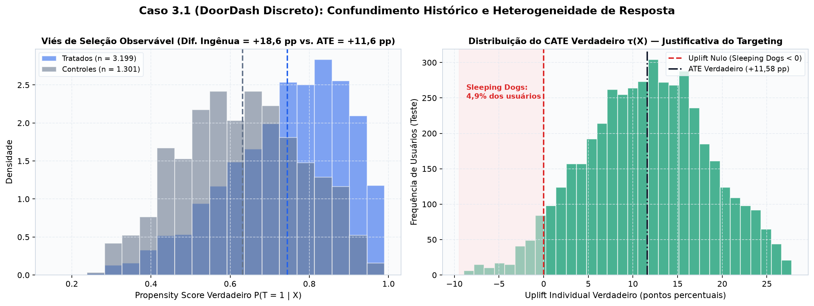
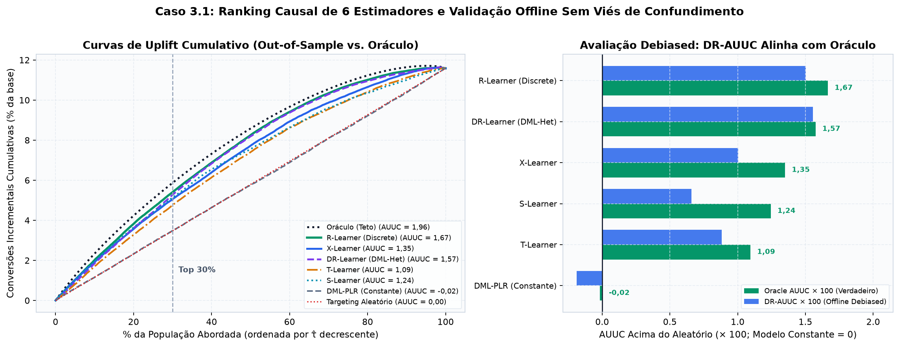
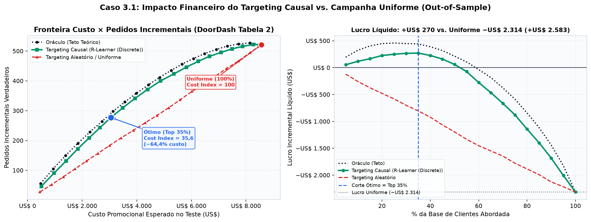
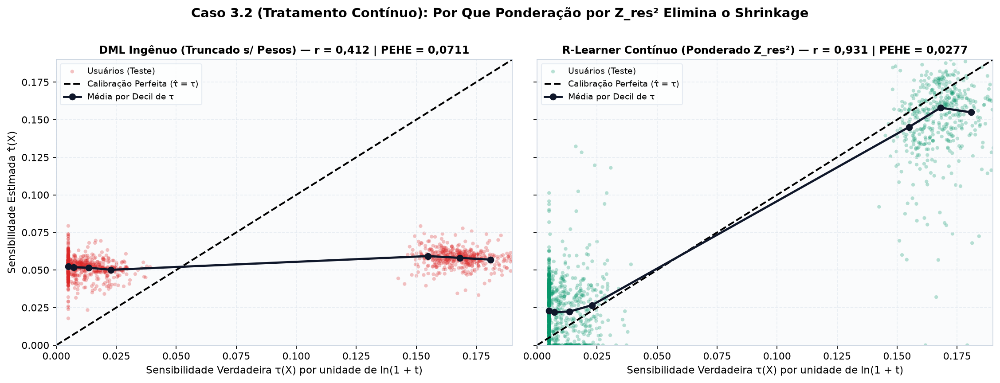
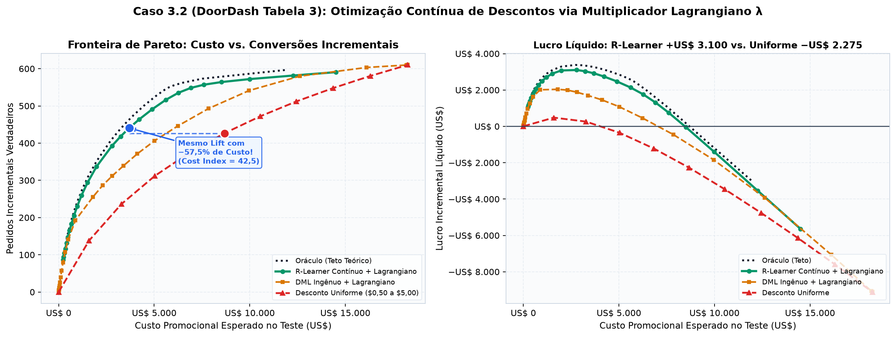
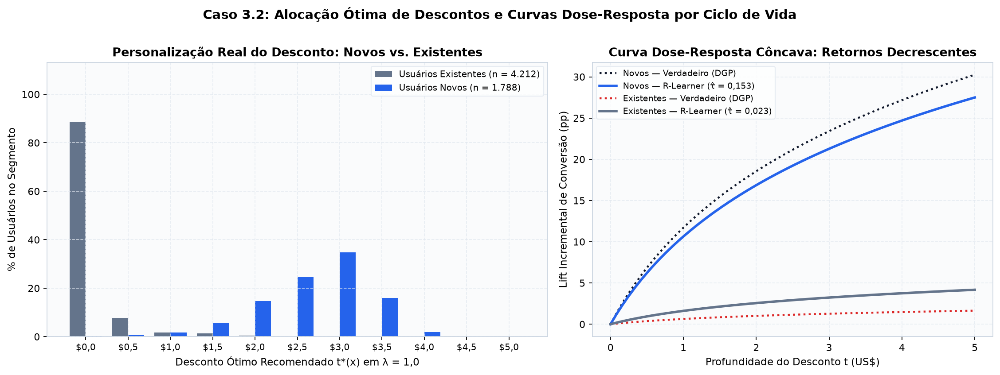

# 🎯 Causal Machine Learning & Uplift Modeling para Otimização de Promoções

<div align="center">

[](https://www.python.org/)
[](./paper.pdf)
[](#estudo-de-caso-31--targeting-discreto-quem-recebe)
[](#como-executar)
[](.)

</div>

---

## 📌 Resumo Executivo

Este projeto reproduz e aprofunda os dois estudos de caso industriais do artigo da **DoorDash** publicado no **KDD 2025 Workshop**:

> **Muxi Xu, Kun Hu, Sudeep Das & Bruce Wang (2025).** *Causal Machine Learning for Promotions: Industry Evidence and Applications.* DoorDash Inc. — veja cópia completa em [`paper.pdf`](./paper.pdf).

O objetivo é resolver, de ponta a ponta, os dois grandes problemas econômicos de campanhas promocionais sob **confundimento observável** (alocação histórica não aleatória):
1. **Estudo de Caso 3.1 — Targeting Discreto (Binário):** *QUEM* deve receber uma promoção fixa (cupom de US\$ 4,50; margem de contribuição de US\$ 12,00/pedido)?
2. **Estudo de Caso 3.2 — Profundidade de Desconto Contínuo (*Dose-Response*):** *QUANTO* de desconto ($t \in [\text{US\$ } 0,\; \text{US\$ } 5]$) oferecer a cada cliente sob retornos decrescentes e orçamento restrito?

### Principais Resultados (Avaliação *Out-of-Sample*)

| Frente de Otimização | Política Baseline (Uniforme) | Política Causal Personalizada | Impacto Econômico |
| :--- | :--- | :--- | :--- |
| **Caso 3.1 — Targeting Discreto (`R-Learner`, Top `35%`)** | Custo `Cost Index = 100` \| Prejuízo `−US$ 2.313,64` | **`Cost Index = 35,6` (`−64,4%` custo)** \| Lucro **`+US$ 269,66`** | **+US\$ 2.583,30** de lucro líquido (reverte prejuízo para lucro!) |
| **Caso 3.2 — Desconto Contínuo (`R-Learner Z_res²`, Iso-Lift)** | Desconto fixo `US$ 2,50`: `US$ 8.673,75` \| `426,6` pedidos | **`US$ 3.690,33` (`Cost Index = 42,5`)** \| **`440,6` pedidos** | **−57,5% de custo** entregando **+3,3% mais pedidos**! |
| **Caso 3.2 — Desconto Contínuo (Lucro Máximo, $\lambda = 1$)** | Prejuízo `−US$ 2.275,43` (`100%` tratados) | Lucro **`+US$ 3.099,67`** (`37,8%` tratados; desconto médio `US$ 0,87`) | **+US\$ 5.375,10** de ganho líquido sobre política uniforme |

> **Destaques Metodológicos Implementados:**
> - **Auditoria de Avaliação *Offline* sob Confundimento:** comprova empiricamente que o *Qini Ingênuo* dá um score enganoso de **`19,61%`** até para um modelo constante (`DML-PLR`, zero poder de ranking), enquanto o **`DR-AUUC`** (*pseudo-outcome* duplamente robusto *out-of-fold* no teste) corrige o viés (`−0,002 ≈ 0`) e alinha fielmente com o Oráculo.
> - **R-Learner Contínuo Ponderado por $Z_{\text{res}}^2$:** substitui a divisão ruidosa e truncada `Y_res / Z_res` sem pesos (que sofria *shrinkage* severo de `11×` e `r = 0,412`) pela minimização da perda de Robinson com `sample_weight = Z_res²`, saltando a correlação contra $\tau(X)$ verdadeiro de **`0,412 → 0,931`** e reduzindo o PEHE em **61%** (`0,0711 → 0,0277`).
> - **Otimização Lagrangiana DoorDash (Eq. 2.2.3):** modela retornos decrescentes $\Delta P(t, X) = \tau(X)\ln(1+t)$ e custo esperado de resgate $c_i(t) = t \cdot P(Y_i=1 \mid t, X_i)$, evitando a degenerescência de modelos lineares de ROI e traçando a **Fronteira de Pareto** completa.

---

## 📊 Estudo de Caso 3.1 — Targeting Discreto (*QUEM* Recebe?)

Simulamos `N = 15.000` usuários (`10.500` treino / `4.500` teste, split estratificado em `(T, Y)`) com forte viés de seleção observável (diferença bruta de **`+18,60 pp`** vs. ATE verdadeiro de **`+11,58 pp`** — viés de `+60,6%`) e heterogeneidade rica incluindo *Persuadables* (`+27,5 pp`), *Sure Things* e *Sleeping Dogs* (`4,9%` com $\tau < 0$).



### Benchmark de 6 Estimadores Causais (*Out-of-Sample*, `N_teste = 4.500`)

| Modelo | ATE Est. (pp) | PEHE (pp) | Pearson $r(\hat\tau,\tau)$ | Spearman $\rho$ | DR-AUUC (*Debiased*) | Oracle AUUC | True Uplift@30% | Qini Ingênuo *(Viesado)* |
| :--- | ---: | ---: | ---: | ---: | ---: | ---: | ---: | ---: |
| 🥇 **R-Learner (Discrete)** | `11,91` | **`3,84`** | **`0,8314`** | **`0,8460`** | `0,01502` | **`0,01666`** | **`18,01 pp`** | `24,27%` |
| 🥈 **DR-Learner (DML-Het)** | `11,75` | `4,56` | `0,7497` | `0,8046` | **`0,01556`** | `0,01575` | `17,57 pp` | `24,67%` |
| 🥉 **X-Learner** | `12,13` | `6,10` | `0,6905` | `0,6872` | `0,01004` | `0,01350` | `16,84 pp` | `23,90%` |
| **S-Learner** | `11,51` | `6,10` | `0,6059` | `0,6315` | `0,00660` | `0,01244` | `17,10 pp` | `23,44%` |
| **T-Learner** | `12,61` | `9,09` | `0,5335` | `0,5535` | `0,00883` | `0,01094` | `15,88 pp` | `25,33%` |
| **DML-PLR (Constante)** | `12,56` | `6,95` | `0,0000` | `0,0000` | `-0,00189` | `-0,00016` | `11,63 pp` | **`19,61%` ⚠️** |



### Economia do Targeting Seletivo (DoorDash Tabela 2)



Ao cortar os 65% inferiores da base (onde o custo esperado do cupom de US\$ 4,50 supera a margem incremental), o **Targeting Causal (`R-Learner`, Top 35%)** reduz o gasto promocional em **64,4% (`Cost Index = 35,6`)** e transforma uma campanha deficitária (**−US\$ 2.314**) em lucrativa (**+US\$ 270**).

---

## 💰 Estudo de Caso 3.2 — Profundidade de Desconto Contínuo (*QUANTO* Dar?)

Simulamos `N = 20.000` usuários (`14.000` treino / `6.000` teste) com descontos contínuos $t \in [\text{US\$ } 0,\; \text{US\$ } 5]$, `15%` de *holdout* controle ($t = 0$), *non-compliance* por teto de cupom, alocação histórica confundida e **curva dose-resposta côncava** $\Delta P(t, X) = \tau(X)\ln(1+t)$.

### DML Contínuo Ingênuo vs. R-Learner Contínuo Ponderado (`sample_weight = Z_res²`)

| Estimador Contínuo | $\hat\tau$ Médio *(Real = 0,0567)* | $\hat\tau$ DP *(Real = 0,0735)* | PEHE ($\tau$) | Pearson $r(\hat\tau,\tau)$ | Spearman $\rho$ |
| :--- | ---: | ---: | ---: | ---: | ---: |
| ❌ **DML Contínuo Ingênuo (Truncado s/ Pesos)** | `0,0537` | `0,0067` *(shrinkage 11×)* | `0,0711` | `0,4120` | `0,3310` |
| ✅ **R-Learner Contínuo (Ponderado `Z_res²`)** | **`0,0621`** | **`0,0637`** | **`0,0277`** | **`0,9310`** | **`0,6531`** |



### Otimização Lagrangiana e Fronteira de Pareto (DoorDash Eq. 2.2.3 & Tabela 3)

Resolvemos $t_i^*(\lambda) = \arg\max_{t \in \{0, 0.5, \dots, 5\}} \big[15 \cdot \widehat{\Delta P}(t, X_i) - \lambda \cdot t \cdot (\hat p_0(X_i) + \widehat{\Delta P}(t, X_i))\big]$ sobre o conjunto de teste:



### Personalização por Ciclo de Vida (Novos vs. Existentes)



Em $\lambda = 1{,}0$, o otimizador atribui **`US$ 0,00` para ~88% dos clientes existentes habituais** (eliminando desperdício em *Sure Things*) e concentra descontos personalizados de **`US$ 2,00` a `US$ 3,50`** nos usuários novos altamente elásticos ao preço.

---

## 📁 Estrutura do Projeto

```text
causal-ml-uplift-marketing/
├── README.md                                        # Documentação completa do estudo
├── paper.pdf                                        # Artigo oficial DoorDash (KDD 2025 Workshop)
├── requirements.txt                                 # Dependências Python
├── .gitignore                                       # Higiene de cache e temporários
├── analise_causal_uplift_doordash.ipynb             # Notebook didático passo a passo (21 células executadas)
├── analise_causal_uplift_doordash.html              # Relatório HTML standalone
├── src/
│   ├── __init__.py
│   ├── uplift_engine.py                             # Simulações, Meta-Learners, DML, R-Learner e Otimizador Lagrangiano
│   └── generate_visuals.py                          # 6 funções modulares plot_* em qualidade de publicação
├── tests/
│   ├── __init__.py
│   └── test_uplift_engine.py                        # 6 testes automatizados (DGP, AUUC, PEHE, R-Learner, Lagrangiano)
└── img/
    ├── 01_caso1_confundimento_heterogeneidade.png   # Confundimento + distribuição de CATE (Caso 3.1)
    ├── 02_caso1_curvas_uplift_auditoria.png         # Curvas de Uplift + Auditoria DR-AUUC vs. Oráculo
    ├── 03_caso1_politica_targeting_economia.png     # Fronteira Custo × Pedidos & Lucro Líquido (Tabela 2)
    ├── 04_caso2_tau_ingenuo_vs_rlearner.png         # DML Ingênuo vs. R-Learner Contínuo (r = 0,41 → 0,93)
    ├── 05_caso2_fronteira_pareto_descontos.png      # Fronteira de Pareto Lagrangiana (Tabela 3)
    └── 06_caso2_personalizacao_dose_resposta.png    # Alocação por ciclo de vida + Curvas Dose-Resposta
```

---

## 🚀 Como Executar

### 1. Instalar Dependências
```bash
pip install -r requirements.txt
```

### 2. Executar Todos os Experimentos e Gerar as 6 Figuras
```bash
python -m src.uplift_engine
python -m src.generate_visuals
```

### 3. Rodar a Suíte de Testes Automatizados (`6/6` testes, `0` warnings)
```bash
python -W default -m unittest discover -s tests -v
```

### 4. Reexecutar o Notebook Didático e Exportar HTML
```bash
jupyter nbconvert --to notebook --execute --inplace analise_causal_uplift_doordash.ipynb
jupyter nbconvert --to html analise_causal_uplift_doordash.ipynb
```

---

## 📚 Referências

1. **Xu, M., Hu, K., Das, S., & Wang, B. (2025).** *Causal Machine Learning for Promotions: Industry Evidence and Applications.* DoorDash Inc., KDD 2025 Workshop ([`paper.pdf`](./paper.pdf)).
2. **Nie, X., & Wager, S. (2021).** *Quasi-Oracle Estimation of Heterogeneous Treatment Effects (R-Learner).* Biometrika.
3. **Kennedy, E. H. (2023).** *Towards Optimal Doubly Robust Estimation of Heterogeneous Causal Effects (DR-Learner).* Electronic Journal of Statistics.
4. **Künzel, S. R., Sekhon, J. S., Bickel, P. J., & Yu, B. (2019).** *Metalearners for Estimating Heterogeneous Treatment Effects using Machine Learning (S/T/X-Learners).* PNAS.
5. **Chernozhukov, V., et al. (2018).** *Double/Debiased Machine Learning for Treatment and Structural Parameters.* The Econometrics Journal.

---

## 👨‍🎓 Autor

**Dr. Silvio da Rosa Paula** — Doutor em Economia Aplicada (UFPel) & Cientista de Dados

[](https://www.linkedin.com/in/silvio-paula/)
[](https://github.com/silviopaula)
[](https://silviopaula.github.io/)
