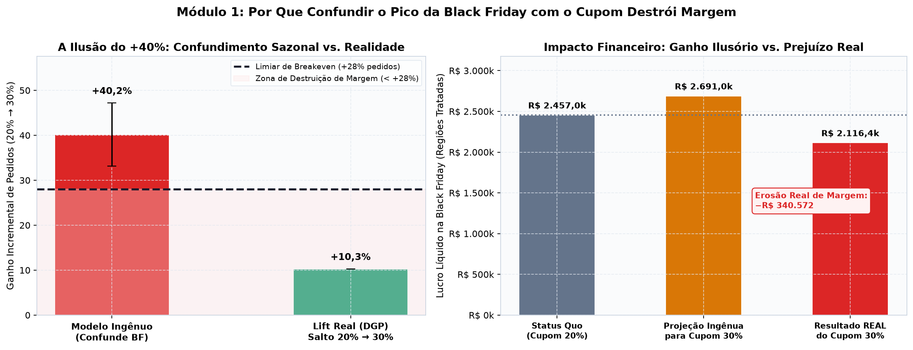
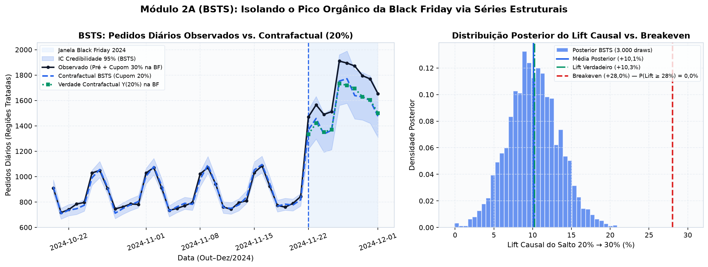
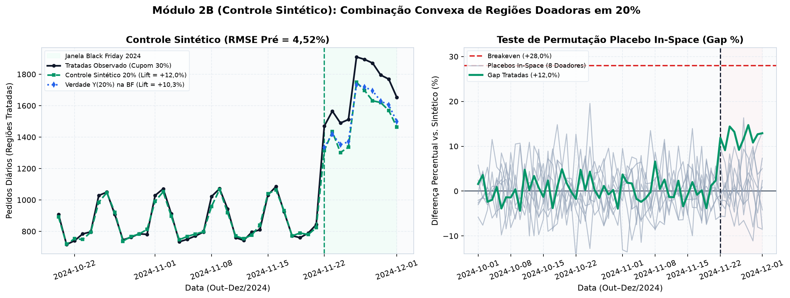
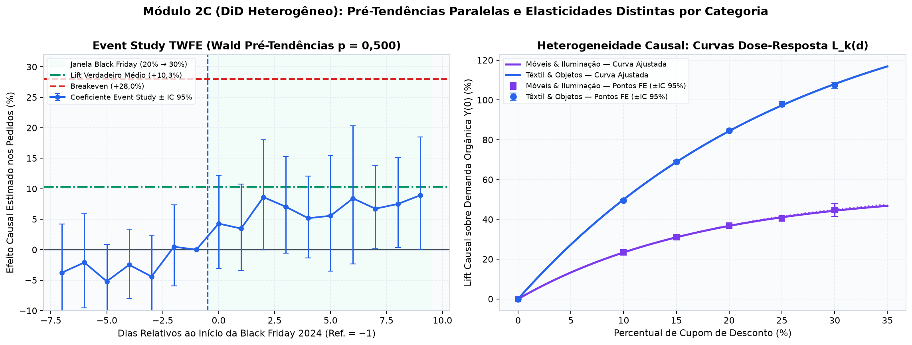
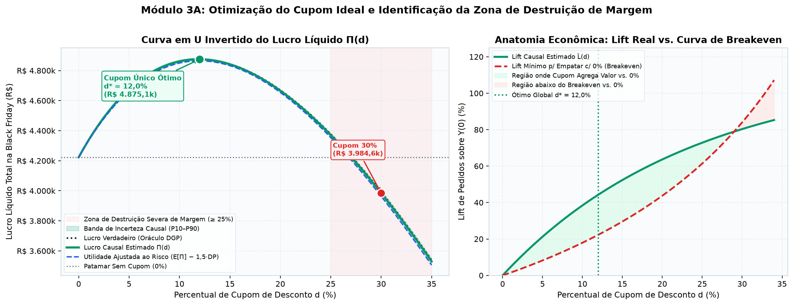
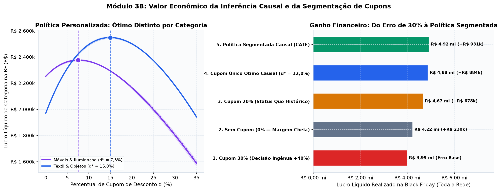

# 🛍️ Inferência Causal & Otimização Prescritiva de Cupom Promocional na Black Friday

<div align="center">

[](https://www.python.org/)
[](#modulo-2--inferencia-causal-isolando-o-calendario-do-cupom)
[](#modulo-3--otimizacao-prescritiva-do-cupom-ideal)
[](#como-executar)

</div>

---

## 📌 Resumo Executivo: Da Ilusão do `+40%` ao Ganho de `+R$ 931 mil` em Margem Líquida

Durante a Black Friday, e-commerces enfrentam uma armadilha clássica: **subir agressivamente o cupom promocional de `20%` para `30%` parece gerar um explosivo aumento de vendas quando olhamos para correlações históricas**, mas grande parte desse salto vem do **pico orgânico de calendário da Black Friday** — e não do desconto adicional!

Construímos um laboratório completo, didático e 100% reprodutível sobre um painel diário de **2 anos (`2023–2024`, `731` dias × `16` unidades região-categoria = `11.696` observações)** de um varejista de casa e decoração, com **Processo Gerador de Dados (DGP) explícito e verdade contrafactual salva para auditoria**:

1. **A Regra de Ouro do *Breakeven* (`+28,00%` exatos):** com ticket cheio `P = R$ 350,00`, margem bruta `m₀ = 72,0%` e custo variável `cᵥ = R$ 22,00/pedido`, subir o cupom de `20%` para `30%` reduz a margem líquida unitária de **`R$ 160,00` para `R$ 125,00`**, exigindo **exatamente `+28,00%` de pedidos incrementais** apenas para empatar o lucro líquido.
2. **A Ilusão Correlacional (`+40,19%`, $p = 2{,}8 \times 10^{-40}$):** um modelo ingênuo que não isola adequadamente o pico sazonal da Black Friday estima **`+40,19%`** de ganho ao escalar de `20%` para `30%` — prometendo **+R\$ 234,0 mil** de lucro extra, mas entregando na prática **−R\$ 340,6 mil de erosão de margem** nas regiões tratadas (**−R\$ 677,6 mil** na rede inteira), pois o efeito causal real do salto `20% → 30%` é de apenas **`+10,26%`**.
3. **Triangulação Causal Convergente:** três famílias independentes (**BSTS**, **Controle Sintético** e **DiD com Heterogeneidade**) isolam o efeito calendário e recuperam a verdade sintética (`+10,26%`), provando com $P(\text{Lift} \ge 28\%) = 0{,}0\%$ que o cupom de `30%` destrói margem.
4. **Otimização Prescritiva e Segmentação por Categoria:** acoplando as curvas causais côncavas $\hat L_k(d)$ à função de lucro líquido $\Pi(d)$, descobrimos o **cupom único ótimo `d* = 12,0%`** e a **Política Segmentada Causal (`7,5%` em *Móveis & Iluminação* | `15,0%` em *Têxtil & Objetos*)**, recuperando **+R\$ 931.361,48** de lucro líquido frente à decisão ingênua de `30%` (**+R\$ 253.732,50** acima do status quo de `20%`)!

---

## 📉 Módulo 1 — O Modelo Ingênuo e a Erosão de Margem ([`01_vies_ingenuo_e_margem.ipynb`](./01_vies_ingenuo_e_margem.ipynb))

| Parâmetro Econômico / Resultado | Valor | Interpretação Executiva |
| :--- | ---: | :--- |
| **Ticket Médio Cheio ($P$) / Margem Bruta ($m_0$) / Custo Variável ($c_v$)** | `R$ 350,00` / `72%` / `R$ 22,00` | Estrutura unitária base antes do cupom |
| **Margem Líquida Unitária: `d = 20%` vs. `d = 30%`** | `R$ 160,00` → `R$ 125,00` | Queda de `-R$ 35,00` por pedido (`-21,9%` de margem unitária) |
| **Lift Mínimo de *Breakeven* (`20% → 30%`)** | **`+28,00%`** | `160 / 125 - 1 = +28,00%` exatos para empatar lucro |
| **Estimativa do Modelo Ingênuo (Confunde BF)** | **`+40,19%`** *(p = 2,8e-40)* | Acima de `+28%` → aprova erroneamente o cupom de `30%`! |
| **Efeito Causal Real (Ground Truth DGP)** | **`+10,26%`** | Abaixo de `+28%` → perda real de **−R\$ 340.572,44** nas regiões tratadas |



---

## 🧪 Módulo 2 — Inferência Causal: Isolando o Calendário do Cupom

Na janela da Black Friday 2024 (`22/nov` a `01/dez/2024`), **4 regiões tratadas** (`8` unidades região-categoria) subiram o cupom para `30%`, enquanto **4 regiões controle** (`8` unidades) mantiveram `20%`. Avaliamos três métodos independentes contra a verdade sintética (`+10,26%`):

| Abordagem Causal | Notebook | Lift Estimado (`20% → 30%`) | Intervalo de 95% | Verdade DGP | Diagnóstico de Validade | Passa no Breakeven (`+28%`)? |
| :--- | :--- | ---: | :---: | ---: | :--- | :---: |
| ❌ **Regressão Ingênua** | [`01_vies_ingenuo_e_margem.ipynb`](./01_vies_ingenuo_e_margem.ipynb) | `+40,19%` | `[33,38%; 47,36%]` | `+10,26%` | Confunde pico orgânico da BF | ⚠️ Falso Positivo |
| ✅ **BSTS (Filtro de Kalman + MC)** | [`02_bsts.ipynb`](./02_bsts.ipynb) | **`+10,10%`** | `[3,78%; 16,74%]` | `+10,26%` | $P(\text{Lift} \ge 28\%) = 0{,}0\%$ (3.000 draws) | ❌ Reprova `30%` |
| ✅ **Controle Sintético (Simplex)** | [`03_controle_sintetico.ipynb`](./03_controle_sintetico.ipynb) | **`+11,99%`** | `[6,54%; 17,45%]` | `+10,26%` | RMSE pré = `4,52%` + 8 Placebos *In-Space* | ❌ Reprova `30%` |
| ✅ **DiD Tradicional (TWFE)** | [`04_did_heterogeneo.ipynb`](./04_did_heterogeneo.ipynb) | **`+8,96%`** | `[3,79%; 14,38%]` | `+10,26%` | Wald Pré-Tendências $p = 0{,}500$ | ❌ Reprova `30%` |
| ✅ **DiD CATE — Móveis & Iluminação** | [`04_did_heterogeneo.ipynb`](./04_did_heterogeneo.ipynb) | **`+6,14%`** | `[2,85%; 9,55%]` | `+5,79%` | Baixa elasticidade ao desconto | ❌ Reprova `30%` |
| ✅ **DiD CATE — Têxtil & Objetos** | [`04_did_heterogeneo.ipynb`](./04_did_heterogeneo.ipynb) | **`+11,85%`** | `[10,57%; 13,14%]` | `+12,82%` | Alta elasticidade (~2× Móveis), mas `< +28%` | ❌ Reprova `30%` |

### 2A. Séries Estruturais em Espaço de Estados — BSTS ([`02_bsts.ipynb`](./02_bsts.ipynb))


### 2B. Controle Sintético & Testes Placebo *In-Space* ([`03_controle_sintetico.ipynb`](./03_controle_sintetico.ipynb))


### 2C. *Difference-in-Differences* Heterogêneo, *Event Study* e Curvas $L_k(d)$ ([`04_did_heterogeneo.ipynb`](./04_did_heterogeneo.ipynb))


---

## 💰 Módulo 3 — Otimização Prescritiva do Cupom Ideal ([`05_otimizacao_cupom_ideal.ipynb`](./05_otimizacao_cupom_ideal.ipynb))

Combinando as curvas causais côncavas estimadas $\hat L_k(d)$ com a função de lucro líquido $\Pi(d) = \sum_k Q_{0,k}(1 + \hat L_k(d))\cdot\text{CM}_k(d)$ e `300` simulações paramétricas de incerteza (cenários `P10 / Base / P90` e aversão ao risco $E[\Pi] - 1{,}5\cdot\text{DP}$):



### Comparativo Financeiro na Black Friday (Toda a Rede — 16 Unidades × 10 Dias)

| Política Promocional | Regra de Cupom | Lucro Líquido Realizado (R\$) | Ganho vs. Cupom 30% | Ganho vs. Status Quo 20% |
| :--- | :--- | ---: | ---: | ---: |
| **1. Cupom 30% (Decisão Ingênua `+40%`)** | `30,0%` uniforme | `R$ 3.992.574,34` | *Baseline do Erro* | `-R$ 677.628,98` |
| **2. Sem Cupom (Margem Cheia)** | `0,0%` uniforme | `R$ 4.222.982,14` | `+R$ 230.407,80` | `-R$ 447.221,18` |
| **3. Cupom 20% (Status Quo Histórico)** | `20,0%` uniforme | `R$ 4.670.203,32` | `+R$ 677.628,98` | `R$ 0,00` |
| **4. Cupom Único Ótimo Causal ($d^* = 12{,}0\%$)** | `12,0%` uniforme | **`R$ 4.876.148,02`** | **`+R$ 883.573,68`** | **`+R$ 205.944,70`** |
| 🏆 **5. Política Segmentada Causal (CATE)** | **Móveis `7,5%` \| Têxtil `15,0%`** | **`R$ 4.923.935,82`** | **`+R$ 931.361,48`** | **`+R$ 253.732,50`** |



---

## 📁 Estrutura do Repositório

```text
causal_lift_margem/
├── README.md                                  # Documentação executiva e didática completa
├── relatorio_didatico_causal_lift_margem.html # Relatório HTML didático autocontido c/ gráficos e simulador interativo
├── requirements.txt                           # Dependências Python
├── .gitignore                                 # Higiene de cache e temporários
├── 01_vies_ingenuo_e_margem.ipynb             # Módulo 1: Breakeven +28%, ilusão do +40% e erosão de margem
├── 02_bsts.ipynb                              # Módulo 2A: BSTS (Filtro de Kalman + 3.000 draws posteriores)
├── 03_controle_sintetico.ipynb                # Módulo 2B: Controle Sintético no simplex + Placebos In-Space
├── 04_did_heterogeneo.ipynb                   # Módulo 2C: DiD TWFE, Event Study, CATE e curvas L_k(d)
├── 05_otimizacao_cupom_ideal.ipynb            # Módulo 3: Curva em U invertido, incerteza e política segmentada
├── data/
│   └── painel_black_friday_cupons.csv         # Painel diário gerado (11.696 linhas c/ contrafactuais salvas)
├── src/
│   ├── __init__.py
│   ├── dgp.py                                 # Gerador de dados sintéticos e calibração financeira exata
│   ├── causal_models.py                       # Regressão ingênua, BSTS, Controle Sintético e DiD Heterogêneo
│   ├── optimizer.py                           # Otimizador prescritivo de margem, risco e segmentação
│   └── visuals.py                             # 6 funções de visualização em qualidade de publicação
├── tests/
│   ├── __init__.py
│   └── test_causal_lift_margem.py             # 5 testes automatizados validando DGP, modelos e otimização
└── img/
    ├── 01_ilusao_41pct_vs_breakeven.png
    ├── 02_bsts_contrafactual_posterior.png
    ├── 03_controle_sintetico_placebo.png
    ├── 04_did_heterogeneo_event_study.png
    ├── 05_curva_lucro_u_invertido.png
    └── 06_politica_segmentada_risco.png
```

---

## 🚀 Como Executar

```bash
# 1. Instalar dependências
pip install -r requirements.txt

# 2. Rodar a suíte de testes automatizados (5/5 aprovados em ~2s, 0 warnings)
python -W default -m unittest discover -s tests -v

# 3. Reexecutar os 5 notebooks em sequência
jupyter nbconvert --to notebook --execute --inplace 01_vies_ingenuo_e_margem.ipynb
jupyter nbconvert --to notebook --execute --inplace 02_bsts.ipynb
jupyter nbconvert --to notebook --execute --inplace 03_controle_sintetico.ipynb
jupyter nbconvert --to notebook --execute --inplace 04_did_heterogeneo.ipynb
jupyter nbconvert --to notebook --execute --inplace 05_otimizacao_cupom_ideal.ipynb
```

---

## 👨‍🎓 Autor

**Dr. Silvio da Rosa Paula** — Doutor em Economia Aplicada (UFPel) & Cientista de Dados

[](https://www.linkedin.com/in/silvio-paula/)
[](https://github.com/silviopaula)
[](https://silviopaula.github.io/)
