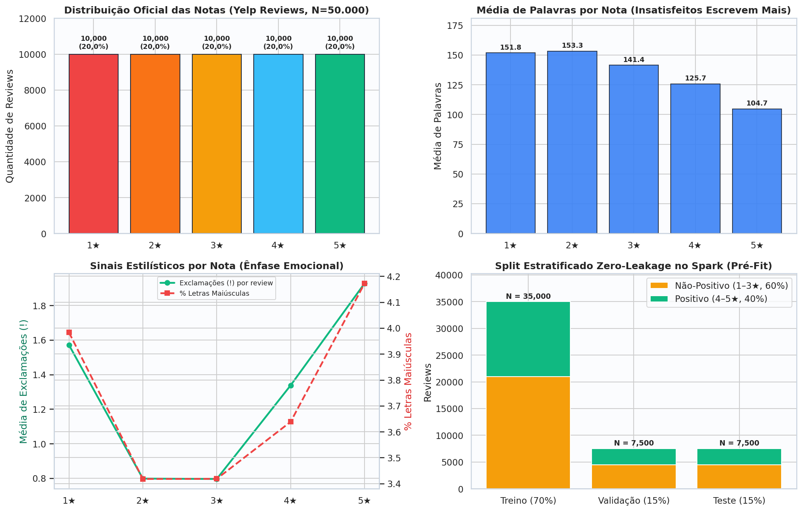
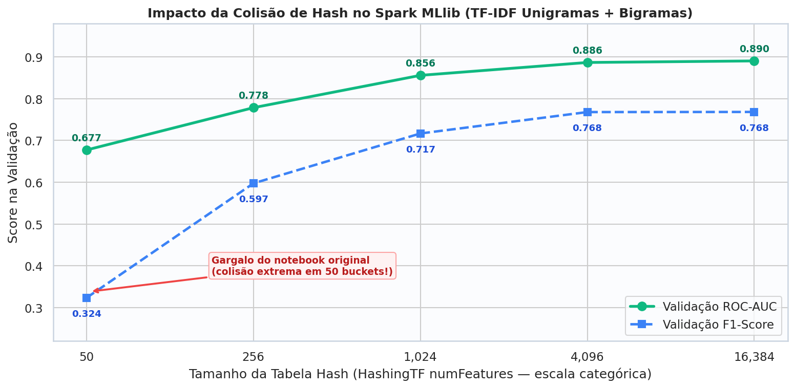
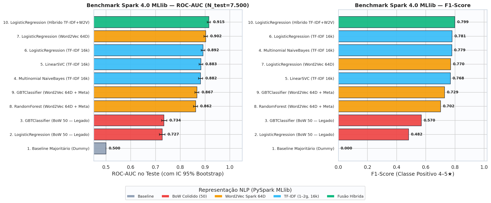
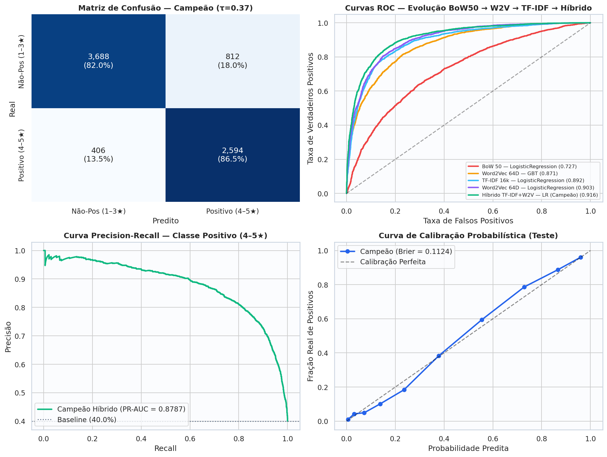
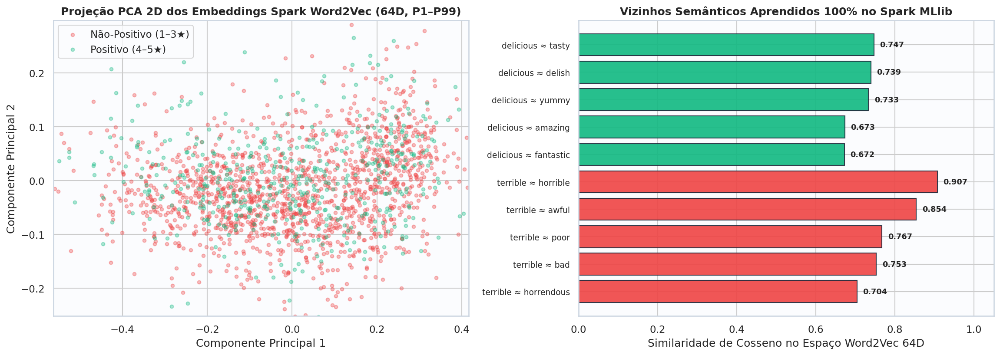
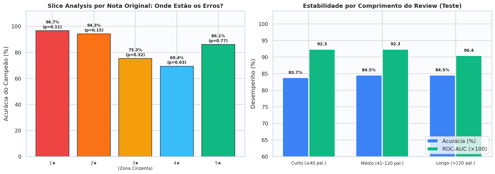

# ⚡ NLP & Classificação Distribuída de Reviews com Apache Spark 4.0 MLlib

<div align="center">


</div>

Pipeline distribuído *end-to-end* de Processamento de Linguagem Natural (**NLP**) e classificação de sentimento construído **100% nativamente em Apache Spark 4.0.1 (`pyspark.ml`)** sobre **50.000 avaliações reais do Yelp (`1–5★`)** em formato colunar Parquet (`16,17 MB`, `zstd`).

O projeto realiza uma auditoria de engenharia sobre falhas clássicas de pipelines NLP distribuídos (colisão extrema de hash em `HashingTF`, *Data Leakage* no ajuste pré-split e remoção indevida de negações) e conduz um benchmark controlado com **10 pipelines Apache Spark MLlib**, **IC 95% Bootstrap**, calibração probabilística, otimização de *threshold* e *Slice-Based Error Analysis*.

---

## 📄 Relatórios Prontos para Leitura

- 📓 **Notebook Executado (Spark 4.0.1):** [`nlp_spark_mllib_classificacao.ipynb`](./nlp_spark_mllib_classificacao.ipynb) *(20 células executadas, 0 erros)*
- 🌐 **Relatório HTML Interativo (Standalone com imagens embutidas):** [`nlp_spark_mllib_classificacao.html`](./nlp_spark_mllib_classificacao.html)

---

## 🎯 Diagnóstico de Engenharia & Melhorias Estruturais

1. **Auditoria & Eliminação da Colisão Extrema de Hash (`HashingTF`):** provamos via *ablation* controlado na Validação que `HashingTF(numFeatures=50)` destrói o sinal léxico (`ROC-AUC 0,6770` / `F1 0,3235`). Expandir progressivamente para **`16.384` buckets + ponderação `IDF` + bigramas** gera um salto de **`+21,3 p.p.` em ROC-AUC** (`0,8900`) e **`+44,5 p.p.` em F1** (`0,7680`).
2. **Zero Data Leakage (Split Pré-Fit no Spark):** particionamento estratificado determinístico por estrela (**Treino `35.000` [70%] / Validação `7.500` [15%] / Teste `7.500` [15%]**) realizado via `Window` + `percent_rank` **antes** de ajustar `IDF`, `Word2Vec` e `StandardScaler`.
3. **Preservação de Negações no `StopWordsRemover`:** remoção explícita de operadores de negação e contraste em inglês (`not`, `no`, `never`, `nor`, `neither`, `don't`, `didn't`, `wasn't`, `can't`, `won't`, `but`, `however`) da lista padrão do Spark MLlib.
4. **Alvo Binário Semanticamente Limpo:** classificação de **Positivo (`4–5★`, 40%)** vs. **Não-Positivo / Atenção (`1–3★`, 60%)**, evitando rotular avaliações elogiosas de 4 estrelas como "negativas".
5. **Execução 100% JVM (Zero Python Workers):** toda a ingestão Parquet, engenharia estilística em Catalyst SQL, tokenização, `Word2Vec`, TF-IDF e treinamento MLlib rodam diretamente na JVM do Spark 4.0 (`spark.api.mode=classic`, AQE ativo), garantindo portabilidade total em Windows/Linux e clusters Databricks.

---

## 📊 Principais Resultados (Conjunto de Teste Cego, `N = 7.500`)

### 1. Ablation de Colisão de Hash (`HashingTF`, Validação `N = 7.500`)

| `HashingTF numFeatures` | Val ROC-AUC | Val F1-Score | Val Acurácia | Tempo Fit (s) |
| ---: | ---: | ---: | ---: | ---: |
| `50` *(Legado)* | `0,6770` | `0,3235` | `63,75%` | `6,05s` |
| `256` | `0,7782` | `0,5973` | `71,87%` | `5,40s` |
| `1.024` | `0,8555` | `0,7165` | `78,68%` | `5,04s` |
| `4.096` | `0,8863` | `0,7677` | `81,91%` | `6,36s` |
| **`16.384`** | **`0,8900`** | **`0,7680`** | **`81,72%`** | `6,95s` |

### 2. Benchmark dos 10 Pipelines Apache Spark 4.0 MLlib (Teste `N = 7.500`)

| # | Pipeline Spark MLlib | Representação | ROC-AUC (IC 95% Bootstrap) | PR-AUC | F1-Score | Acurácia | Treino (s) |
| :-: | :--- | :--- | :---: | :---: | :---: | :---: | ---: |
| 🏆 | **10. LogisticRegression (Híbrido TF-IDF+W2V)** | **Fusão Híbrida** | **`0,9155`** `[0,9083; 0,9213]` | **`0,8778`** | **`0,7991`** *(0,8090 em τ=0,37)* | **`84,36%`** | `7,38s` |
| 2 | 7. LogisticRegression (Word2Vec 64D) | Word2Vec Spark 64D | `0,9025` `[0,8950; 0,9094]` | `0,8549` | `0,7702` | `82,56%` | `6,23s` |
| 3 | 6. LogisticRegression (TF-IDF 16k) | TF-IDF (1–2g, 16k) | `0,8920` `[0,8840; 0,8990]` | `0,8417` | `0,7810` | `82,73%` | `7,60s` |
| 4 | 5. LinearSVC (TF-IDF 16k) | TF-IDF (1–2g, 16k) | `0,8833` `[0,8754; 0,8906]` | `0,8294` | `0,7684` | `81,43%` | `12,04s` |
| 5 | 4. Multinomial NaiveBayes (TF-IDF 16k) | TF-IDF (1–2g, 16k) | `0,8821` `[0,8735; 0,8902]` | `0,8158` | `0,7786` | `81,20%` | **`0,49s`** |
| 6 | 9. GBTClassifier (Word2Vec 64D + Meta) | Word2Vec Spark 64D | `0,8674` `[0,8593; 0,8749]` | `0,8154` | `0,7292` | `79,33%` | `18,97s` |
| 7 | 8. RandomForest (Word2Vec 64D + Meta) | Word2Vec Spark 64D | `0,8620` `[0,8534; 0,8696]` | `0,8123` | `0,7017` | `78,53%` | `5,72s` |
| 8 | 3. GBTClassifier (BoW 50 — Legado) | BoW Colidido (50) | `0,7344` `[0,7243; 0,7455]` | `0,6572` | `0,5701` | `69,28%` | `16,05s` |
| 9 | 2. LogisticRegression (BoW 50 — Legado) | BoW Colidido (50) | `0,7269` `[0,7157; 0,7380]` | `0,6237` | `0,4819` | `68,17%` | `5,13s` |
| 10 | 1. Baseline Majoritário (Dummy) | Baseline | `0,5000` `[0,5000; 0,5000]` | `0,4000` | `0,0000` | `60,00%` | `0,00s` |

### 3. Principais Achados Científicos

- **Complementaridade Esparsa + Densa:** `Word2Vec 64D` + `LogisticRegression` venceu `TF-IDF 16k` em `ROC-AUC` (`0,9025` vs. `0,8920`), enquanto `TF-IDF (1–2g, 16k)` liderou em `F1` (`0,7810` vs. `0,7702`). A **Fusão Híbrida (`TF-IDF 16k + Word2Vec 64D + Metadados Estilísticos`)** superou todos os modelos isolados em **todas** as métricas (`ROC-AUC 0,9155`, `PR-AUC 0,8778`, `F1 0,8090` com threshold otimizado `τ = 0,37`, `Brier 0,1128`).
- **Semântica Nativa no Spark `Word2Vec` (`16,62s`):** sem nenhum arquivo externo pré-treinado, o Spark aprendeu automaticamente relações de domínio e polaridade (`delicious` ≈ `tasty 0,747`, `delish 0,739`, `yummy 0,733`; `terrible` ≈ `horrible 0,907`, `awful 0,854`; `friendly` ≈ `helpful 0,887`, `polite 0,867`).
- **Slice-Based Error Analysis:** acurácia de **`96,7%` em `1★`** (`p = 0,11`), **`94,3%` em `2★`** (`p = 0,15`) e **`86,1%` em `5★`** (`p = 0,77`), com concentração natural de incerteza na fronteira mista `3★/4★` (`75,3%` / `69,4%`) e estabilidade total por tamanho do texto (`ROC-AUC 0,923` em textos curtos/médios e `0,904` em relatos longos).

---

## 🖼️ Galeria Visual

| EDA Distribuída & Sinais Estilísticos | Ablation de Colisão de Hash (`HashingTF`) |
| :---: | :---: |
|  |  |

| Benchmark 10 Pipelines Spark 4.0 MLlib | Diagnóstico, ROC/PR & Calibração do Campeão |
| :---: | :---: |
|  |  |

| Espaço Semântico Word2Vec 64D (PCA + Vizinhos) | Slice-Based Error Analysis (Estrelas & Tamanho) |
| :---: | :---: |
|  |  |

---

## 🏗️ Arquitetura do Projeto

```text
classificacao-reviews-spark-NLP/
├── data/
│   └── yelp_reviews_spark.parquet         # 50.000 avaliações reais do Yelp (16,17 MB, zstd)
├── outputs/
│   ├── figures/                           # 6 figuras analíticas em alta resolução (PNG)
│   └── metrics_summary.json               # Métricas auditadas, IC 95%, ablation, sinônimos e slices
├── src/
│   ├── __init__.py
│   ├── prepare_data.py                    # Garantia/download reproduzível do dataset Parquet oficial
│   ├── spark_nlp_mllib.py                 # Pipeline completo Apache Spark 4.0 MLlib + geração de figuras
│   └── build_notebook.py                  # Construtor do notebook didático a partir das métricas auditadas
├── tests/
│   └── test_spark_nlp.py                  # Suíte unittest (4 testes: negações, features, split, bootstrap)
├── nlp_spark_mllib_classificacao.ipynb    # Notebook Jupyter executado no kernel PySpark 4.0.1
├── nlp_spark_mllib_classificacao.html     # Relatório HTML standalone com gráficos embutidos
├── requirements.txt
└── README.md
```

---

## 🚀 Como Reproduzir Localmente

> **Pré-requisito JVM:** Apache Spark 4.0 requer **JDK 17 ou JDK 21** (o módulo `configure_java_for_spark()` detecta automaticamente `C:\Program Files\Java\jdk-17` ou `jdk-21` no Windows).

```bash
# 1. Instalar dependências (ambiente Python com PySpark 4.x)
pip install -r requirements.txt

# 2. Executar suíte de testes unitários (4/4 OK)
python -m unittest discover -s tests -v

# 3. Rodar o benchmark distribuído completo dos 10 pipelines + 6 figuras
python src/spark_nlp_mllib.py

# 4. (Opcional) Reconstruir o notebook e exportar HTML standalone
python src/build_notebook.py
jupyter nbconvert --to html --embed-images nlp_spark_mllib_classificacao.ipynb
```
