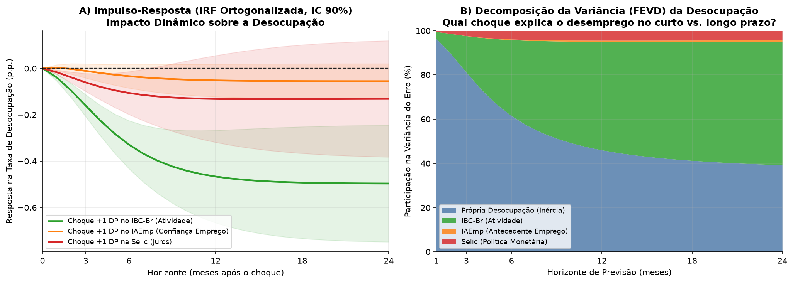
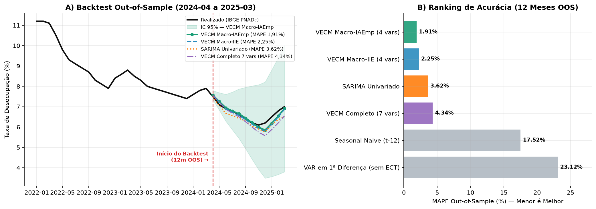
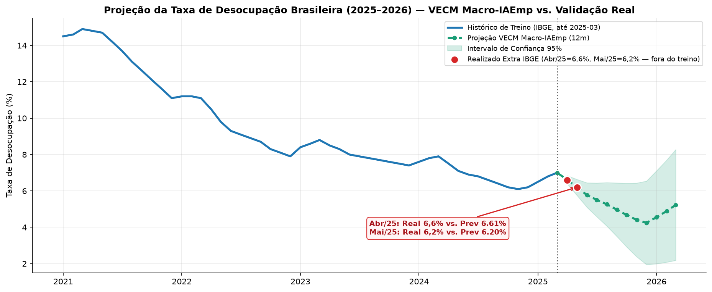

# 📉 Cointegração e Previsão da Taxa de Desocupação no Brasil com Modelo VECM

<div align="center">


</div>

Modelagem econométrica multivariada, análise de equilíbrio de longo prazo e previsão da **taxa de desocupação brasileira (PNAD Contínua / IBGE)** utilizando o **Modelo Vetorial de Correção de Erros (VECM)** em **Python (`statsmodels`)**, com validação *out-of-sample* rigorosa de 12 meses e auditoria contra divulgações reais do IBGE.

---

## 🎯 Visão Geral do Projeto

Em vez de prever o desemprego apenas por sua própria trajetória passada, o **VECM** combina **equilíbrios econômicos de longo prazo (cointegração)** entre a taxa de desocupação e os fundamentos macroeconômicos brasileiros — **atividade econômica (`IBC-Br`)**, **taxa básica de juros (`Selic`)**, **antecedente de emprego (`IAEmp/FGV`)** e **incerteza econômica (`IIE-Br/FGV`)** — com **dinâmicas de curto prazo** e **sazonalidade mensal**.

### Principais entregas e diferenciais metodológicos
- **Testes completos de raiz unitária (ADF + KPSS)** em **nível e 1ª diferença**, distinguindo séries $I(1)$ de séries estacionárias em nível $I(0)$.
- **Seleção parcimoniosa de defasagens (BIC/HQIC)** e **Teste de Cointegração de Johansen** (consenso entre **Traço** e **Máximo Autovalor**).
- **Interpretação estrutural**: vetor de cointegração ($\beta$, confirmando a **Lei de Okun** no Brasil), velocidades de correção de erro ($\alpha$, meia-vida de ajuste e exogeneidade fraca da Selic), **Causalidade de Granger**, **Funções Impulso-Resposta (IRF)** e **Decomposição da Variância (FEVD)**.
- **Backtest *Out-of-Sample* Honesto (12 meses: `2024-04` a `2025-03`)** comparando 6 modelos concorrentes (`VECM Macro-IAEmp`, `VECM Macro-IIE`, `VECM Completo 7 vars`, `SARIMA`, `Seasonal Naive` e `VAR em 1ª Diferença`).
- **Auditoria Extra Real (`2025-04` e `2025-05`)**: conferência das previsões contra dois meses reais divulgados pelo IBGE mantidos totalmente fora do treinamento.

---

## 📊 Principais Resultados Verificados

### 1. Equilíbrio de Longo Prazo, Diagnósticos e Dinâmica Estrutural (`VECM Macro-IAEmp`)
- **Consenso de Johansen (`k_ar_diff = 1`, `seasons = 12`)**: tanto o teste do **Traço** (`56,81 > 47,85`) quanto o de **Máximo Autovalor** (`31,74 > 27,59`) identificam exatamente **`r = 1` vetor de cointegração** a 5%.
- **Relação de Equilíbrio (Lei de Okun)**: avanços no **IBC-Br** (`-0,7755`) e no **IAEmp** (`-0,1134`) reduzem a taxa de desocupação de longo prazo.
- **Velocidade de Correção de Erro ($\alpha$)**: $\alpha_{\text{desoc}} = -0{,}0253$ ($p < 0{,}0001$, meia-vida de $\approx 27$ meses); já a **Selic** é **fracamente exógena** ($\alpha_{\text{selic}} = -0{,}0010$, $p = 0{,}918$).
- **Diagnósticos da Equação da Desocupação**: resíduos comportam-se como **ruído branco gaussiano** — **Ljung-Box(12)** $p = 0{,}4383$, **Jarque-Bera** $p = 0{,}3789$, desvio-padrão residual = `0,115 p.p.`.
- **Causalidade de Granger & FEVD (24 meses)**: `IBC-Br` causa a desocupação no sentido de Granger ($F = 9{,}00, p = 0{,}0001$; teste conjunto $p < 0{,}0001$) e passa a explicar **`55,8%`** da variância do erro de previsão do desemprego no horizonte de 24 meses (`39,2%` inércia própria, `4,4%` Selic, `0,7%` IAEmp).



---

### 2. Backtest *Out-of-Sample* (12 Meses: `2024-04` a `2025-03`)

| Modelo | RMSE (p.p.) | MAE (p.p.) | MAPE (%) | Ganho vs. Naive | Cobertura IC 95% |
| :--- | :---: | :---: | :---: | :---: | :---: |
| ⭐ **VECM Macro-IAEmp (4 vars, `k=1, r=1`)** | **`0,168`** | **`0,126`** | **`1,91%`** | **`+89,1%`** | **`100%`** |
| **VECM Macro-IIE (4 vars, `k=1, r=1`)** | `0,197` | `0,147` | `2,25%` | `+87,2%` | `100%` |
| **SARIMA Univariado `(1,1,1)×(1,1,0,12)`** | `0,282` | `0,239` | `3,62%` | `+79,3%` | `100%` |
| **VECM Completo (7 vars, `k=1, r=3`)** | `0,360` | `0,284` | `4,34%` | `+75,2%` | `100%` |
| **Seasonal Naive ($y_{t-12}$)** | `1,168` | `1,158` | `17,52%` | `0,0%` | — |
| **VAR em 1ª Diferença (sem cointegração)** | `1,582` | `1,510` | `23,12%` | `-32,0%` | — |

> **Lição econométrica central:** descartar o termo de correção de erro (VAR em 1ª diferença) dispara o erro para `23,12%`, e sobreparametrizar o sistema com 7 variáveis piora o MAPE para `4,34%`. O **VECM parcimonioso (4 variáveis)** reduz o erro em **`-47,2%` frente ao SARIMA univariado**!



---

### 3. Auditoria Real Fora do Treino (`2025-04` e `2025-05`) e Projeção 2025–2026

Reajustado até março/2025 (`157` meses) e testado contra as duas divulgações reais subsequentes do IBGE (não vistas pelo modelo):

| Mês | Realizado IBGE | Previsto VECM Macro-IAEmp | IC 95% | Erro (p.p.) |
| :---: | :---: | :---: | :---: | :---: |
| **2025-04** | `6,60%` | **`6,61%`** | `[6,39%; 6,84%]` | **`-0,01`** |
| **2025-05** | `6,20%` | **`6,20%`** | `[5,76%; 6,64%]` | **`0,00`** |



---

## 📁 Estrutura do Projeto

```text
cointegracao-johansen-vecm-desemprego/
├── data/
│   └── macro_desocupacao_brasil.csv          # Base mensal limpa (2012-03 a 2025-05)
├── img/
│   ├── series_macro_brasil_corrigidas.png    # EDA das 7 séries macroeconômicas + correlações
│   ├── johansen_autovalores_equilibrio.png   # Teste do Traço de Johansen + Termo ECT_t
│   ├── irf_fevd_desocupacao.png              # Funções Impulso-Resposta (IRF) + FEVD
│   ├── backtest_12m_modelos_comparacao.png   # Backtest 12m OOS (6 modelos concorrentes)
│   └── projecao_vecm_validacao_2025_2026.png # Projeção 2025–2026 + auditoria real Abr–Mai/25
├── outputs/
│   └── projecao_desocupacao_vecm.csv         # Tabela de projeções pontuais e IC 95% (12 meses)
├── vecm_cointegracao_desocupacao.ipynb       # Notebook principal didático e executável em Python
├── vecm_cointegracao_desocupacao.html        # Relatório HTML pronto para leitura no navegador
├── requirements.txt                          # Dependências Python
└── README.md
```

---

## 🚀 Como Reproduzir

```bash
cd cointegracao-johansen-vecm-desemprego
pip install -r requirements.txt
jupyter lab vecm_cointegracao_desocupacao.ipynb
```

Para visualização imediata sem executar código, abra [`vecm_cointegracao_desocupacao.html`](./vecm_cointegracao_desocupacao.html) no navegador.

---

## 👨‍💻 Autor

**Silvio da Rosa Paula** — Doutor em Economia Aplicada | Cientista de Dados  
[LinkedIn](https://www.linkedin.com/in/silvio-paula/) • [Portfólio Web](https://silviopaula.github.io/)
