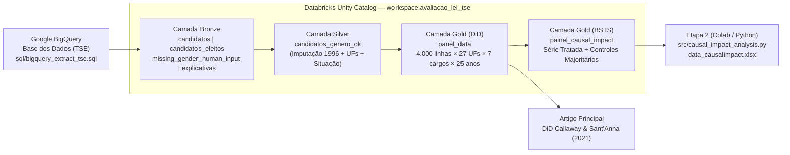

# ⚡ Impacto Causal da Lei nº 12.034/2009 nas Eleições Brasileiras (Databricks + PySpark + CausalImpact)

<div align="center">


-4285F4?style=for-the-badge&logo=googlebigquery&logoColor=white)


</div>

Pipeline de engenharia de dados distribuída em **Databricks (PySpark + Unity Catalog / Delta Lake)** e preparação econométrica para avaliar o **impacto causal da Lei nº 12.034/2009 (*Minirreforma Eleitoral*)** sobre a participação feminina nas eleições proporcionais brasileiras (**1998–2022**), utilizando microdados oficiais do **Tribunal Superior Eleitoral (TSE)** via **Google BigQuery (Base dos Dados)**.

> **Nota Acadêmica:** Este projeto compõe a infraestrutura de dados complementar ao artigo científico sobre os efeitos causais da Lei nº 12.034/2009 na participação política feminina, que utiliza o estimador de **Diferenças em Diferenças em Múltiplos Períodos de Callaway & Sant'Anna (2021)** em conjunto com análise contrafactual via **CausalImpact (BSTS)**.  
> **Nota de Execução:** O processamento PySpark foi executado originalmente em workspace gerenciado **Databricks Unity Catalog** (`workspace.avaliacao_lei_tse.*`). Por depender das tabelas internas do workspace, os *outputs* originais da execução foram preservados no notebook e no relatório HTML exportado, acompanhados pelos scripts modulares prontos para implantação via **Databricks Asset Bundle (`config/databricks.yml`)**.

---

## 📄 Relatórios & Artefatos Prontos para Leitura

- 🌐 **Relatório HTML Exportado do Databricks:** [`Databricks Python Spark - Prepare datapanel.html`](./Databricks%20Python%20Spark%20-%20Prepare%20datapanel.html)
- 📓 **Notebook PySpark / Databricks (revisado, outputs preservados):** [`Databricks Python Spark - Prepare datapanel.ipynb`](./Databricks%20Python%20Spark%20-%20Prepare%20datapanel.ipynb)
- 📊 **Painel Gold Anual Exportado (`1998–2022`):** [`data_causalimpact.xlsx`](./data_causalimpact.xlsx)

---

## 🏗️ Arquitetura Medallion (BigQuery → Databricks → Inferência Causal)



---

## ⚖️ Contexto Institucional & Desenho de Identificação Causal

### A Mudança Legal (Lei nº 12.034/2009 — Art. 10, §3º da Lei das Eleições)
- **Antes de 2009:** partidos deveriam apenas *"reservar"* 30% das vagas, criando brecha legal que permitia deixar vagas ociosas sem lançar candidatas.
- **A partir de 2009:** substituição do verbo para ***"preencher"*** o mínimo de **30%** e máximo de **70%** de candidaturas por gênero — sob pena de indeferimento do **DRAP** (*Demonstrativo de Regularidade de Atos Partidários*) e cassação da chapa em casos de fraude (*"candidaturas laranja"*, **Súmula 73 do TSE**).
- **Vinculação Financeira (2017–2018):** Resoluções **TSE nº 23.553/2017** e **nº 23.575/2018** vincularam no mínimo **30% do Fundo Partidário, do FEFC e do tempo de rádio/TV** às candidaturas femininas, impulsionando um salto de **`+52,6%` de mulheres eleitas em 2018** (`290` eleitas vs. `190` em 2014).

### Desenho Quase-Experimental (Tratamento Escalonado vs. Controles)
| Grupo | Cargos Abrangidos | Vigência Efetiva da Lei | Papel Econométrico |
| :--- | :--- | :---: | :--- |
| **Tratado (Proporcionais Federais/Estaduais)** | `deputado federal`, `deputado estadual`, `deputado distrital` | **2010** (`ano_trat = 2010`) | Coorte 1 — sujeita à cota de 30% |
| **Tratado (Proporcional Municipal)** | `vereador` | **2012** (`ano_trat = 2012`) | Coorte 2 — tratamento escalonado |
| **Controle (Majoritários)** | `governador`, `prefeito`, `senador` | **Nunca tratados** (`ano_trat = 0`) | Contrafactual natural (isentos de cota) |

---

## 📊 Principais Evidências & Auditorias da Execução no Databricks

1. **Resgate Histórico de Gênero (Eleição de 1996 — 100% Ausente no TSE):**
   - Pipeline em 2 estágios em PySpark: propagação probabilística pela moda do primeiro nome em pleitos rotulados + tabela de validação humana nominal (`missing_gender_human_input`).
   - **Auditoria registrada:** **`12.537` registros sem gênero → `0` registros sem gênero (`100%` recuperados)**.
2. **Integridade do Painel Gold (`workspace.avaliacao_lei_tse.panel_data`):**
   - **Dimensão:** **`4.000` linhas**, **`27` UFs**, **`7` cargos padronizados**, **`25` anos (`1998–2022`)**, com **`0` duplicatas** na chave primária `sigla_uf × cargo_std × ano` e faixas validadas (`prop_candidatas ∈ [0,00; 0,75]`, `prop_eleitas ∈ [0,00; 1,00]`).
   - Balanceamento intereleitoral via **LOCF** (*Last Observation Carried Forward*) com `Window` particionada por `(sigla_uf, cargo_std)` e enriquecimento com covariáveis estaduais (`IDHM`, renda, educação, longevidade, proporção de eleitoras, população e segurança pública).
3. **Salto Empírico Pós-Lei nº 12.034/2009 (Cargos Proporcionais Tratados):**
   - **Pré-Lei (`1998–2009`):** média de **`16,23%`** de candidaturas femininas (estável entre `16,18%` e `16,35%`).
   - **Pós-Lei (`2010–2022`):** média de **`29,10%`**, atingindo **`35,25%` em 2022** — avanço médio de **`+12,87 p.p.` (`+79,3%` relativo)** sobre o patamar pré-reforma!

---

## 📂 Estrutura do Repositório

```text
databricks-impacto-causal-lei-cotas-genero-eleicoes/
├── config/
│   └── databricks.yml                                     # Databricks Asset Bundle (DAB) — Workflow Medallion
├── sql/
│   └── bigquery_extract_tse.sql                           # Queries BigQuery (Base dos Dados) para ingestão Bronze
├── src/
│   ├── databricks_etl_pipeline.py                         # ETL PySpark modular (Bronze -> Silver -> Gold)
│   └── causal_impact_analysis.py                          # Script de referência Etapa 2 (CausalImpact BSTS + Placebo)
├── Databricks Python Spark - Prepare datapanel.ipynb      # Notebook Databricks revisado (outputs preservados)
├── Databricks Python Spark - Prepare datapanel.html       # Exportação HTML original do Databricks
├── data_causalimpact.xlsx                                 # Painel Gold anual (1998–2022, 17 variáveis)
├── requirements.txt                                       # Dependências limpas e curadas
├── .gitignore
└── README.md
```

---

## 🚀 Como Implantar no Databricks (Workflows / Asset Bundle)

1. **Ingestão Upstream (BigQuery → Bronze):** execute as consultas em [`sql/bigquery_extract_tse.sql`](./sql/bigquery_extract_tse.sql) e carregue as tabelas no catálogo Unity Catalog (`workspace.avaliacao_lei_tse`).
2. **Deploy via Databricks CLI (Asset Bundles):**
   ```bash
   databricks bundle validate -f config/databricks.yml
   databricks bundle deploy -t dev -f config/databricks.yml
   databricks bundle run tse_lei_12034_panel_pipeline -t dev -f config/databricks.yml
   ```
3. **Etapa 2 (CausalImpact / BSTS em ambiente Python/Colab):**
   ```bash
   pip install -r requirements.txt
   pip install pycausalimpact
   python src/causal_impact_analysis.py
   ```

---

## 📚 Fonte dos Dados & Referências

- **Tribunal Superior Eleitoral (TSE) via Base dos Dados (Google BigQuery):** [`basedosdados.br_tse_eleicoes.candidatos`](https://console.cloud.google.com/bigquery?p=basedosdados&d=br_tse_eleicoes&t=candidatos)
- **TSE (2019):** [*Número de mulheres eleitas em 2018 cresce 52,6% em relação a 2014*](https://www.tse.jus.br/comunicacao/noticias/2019/Marco/numero-de-mulheres-eleitas-em-2018-cresce-52-6-em-relacao-a-2014)
- **Brodersen et al. (2015):** *Inferring causal impact using Bayesian structural time-series models*, Annals of Applied Statistics.
- **Callaway & Sant'Anna (2021):** *Difference-in-Differences with multiple time periods*, Journal of Econometrics.
