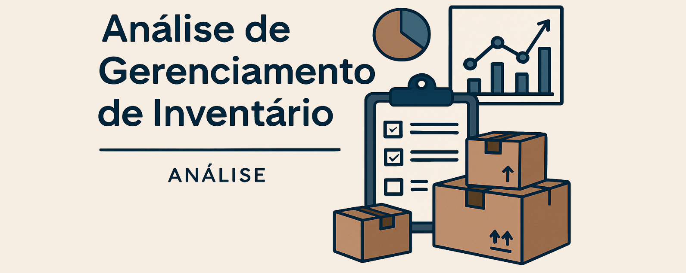

# 📦 Gestão Estratégica de Estoques com Machine Learning (Clusterização + Classificação)

<div align="center">




**Pipeline end-to-end sem *Data Leakage* combinando Clusterização (PCA, K-Means, GMM e KNN) e Classificação (LightGBM, XGBoost e Random Forest) para otimizar um inventário de 198.917 SKUs**

</div>

---

## 📋 Sumário

- [Sobre o Projeto](#-sobre-o-projeto)
- [Arquitetura Sem Data Leakage](#-arquitetura-sem-data-leakage)
- [Principais Resultados](#-principais-resultados)
- [Otimização de Threshold por Estratégia de Estoque](#-otimização-de-threshold-por-estratégia-de-estoque)
- [Plano Acionável no Inventário Ativo (122.921 SKUs)](#-plano-acionável-no-inventário-ativo-122921-skus)
- [Estrutura do Projeto](#-estrutura-do-projeto)
- [Como Executar](#-como-executar)
- [Autor](#-autor)

---

## 🎯 Sobre o Projeto

Manter produtos parados em estoque imobiliza capital de giro e gera custos contínuos de armazenagem. Na base real analisada (`data/SalesKaggle3.csv`, **198.917 registros**):
- **Base Histórica (`Historical`)**: `75.996` SKUs, dos quais apenas **`17,10%` (`12.996`) venderam** nos últimos 6 meses (**82,9%** ficaram encalhados).
- **Inventário Ativo (`Active`)**: `122.921` SKUs atualmente em estoque sem registro futuro de venda.

O objetivo é construir um pipeline completo de Machine Learning que:
1. Segmenta o portfólio de forma não-supervisionada (**K-Means**, **GMM** e **Densidade KNN** sobre espaço **PCA**).
2. Prediz a probabilidade individual de giro (`prob_venda`) de cada SKU.
3. Traduz as probabilidades em decisões executivas (**Manter**, **Monitorar/Promover** ou **Liquidar/Desinvestir**) calibráveis por *threshold* de negócio.

---

## 🏗️ Arquitetura Sem *Data Leakage*

Um erro clássico em projetos que unem clusterização e classificação é ajustar `PCA`, `K-Means` e `GMM` na base inteira antes do *split* treino/teste. Neste projeto, toda a camada não-supervisionada foi encapsulada em um transformador customizado do `scikit-learn` (`UnsupervisedClusterFeatures`) dentro de um **`Pipeline` portável**:
1. **Split Estratificado Inicial (80% / 20%)**: `60.796` SKUs em Treino e `15.200` SKUs em Teste Holdout.
2. **Camada Não-Supervisionada (`.fit()` exclusivo no Treino)**:
   - `PowerTransformer(Yeo-Johnson)` $\rightarrow$ `PCA` (8 componentes retendo 95% da variância).
   - `K-Means (k=4)`: cluster, distância ao próprio centroide e razão de fronteira (`km_dist_ratio`).
   - `Gaussian Mixture Model (GMM)`: probabilidade máxima, margem de decisão e entropia normalizada.
   - `NearestNeighbors (KNN, k=10)`: distância média aos 10 vizinhos mais próximos (proxy inverso de densidade local).
3. **Estudo de Ablação (*Ablation Study*) + Benchmark de 5 Classificadores**: Avaliação transparente em **ROC-AUC** e **PR-AUC** (*Average Precision*, essencial para 17,1% de positivos).

---

## 📈 Principais Resultados

### 1. Segmentos Naturais Descobertos pelo K-Means (Sem Ver o Target)

| Cluster | Qtd. SKUs (Treino) | Taxa Real de Venda | Preço Mediano (`PriceReg`) | Estoque Mediano (`ItemCount`) | Mix Marketing Padrão (S) |
| :---: | :---: | :---: | :---: | :---: | :---: |
| **Cluster 1** *(Alto Giro)* | `14.107` | **`34,99%`** | `123,60` | `60` | `9,9%` |
| **Cluster 3** *(Intermediário)* | `12.739` | `16,36%` | `68,00` | `28` | `41,3%` |
| **Cluster 2** *(Baixo Giro)* | `17.326` | `10,07%` | `60,00` | `35` | `96,8%` |
| **Cluster 0** *(Baixo Giro)* | `16.624` | `9,82%` | `85,00` | `24` | `56,3%` |

### 2. Leaderboard no Conjunto de Teste Holdout (`15.200` SKUs Nunca Vistos)

| Modelo | ROC-AUC | PR-AUC *(Base = 0,171)* | Precision (@0,50) | Recall (@0,50) | F1-Score (@0,50) |
| :--- | :---: | :---: | :---: | :---: | :---: |
| **LightGBM (Sem Clusterização — Ablação)** | **`0,7653`** | **`0,4217`** | `58,59%` | `14,43%` | `0,2316` |
| **Random Forest** | `0,7636` | `0,4213` | `60,27%` | `13,54%` | `0,2212` |
| **HistGradientBoosting** | `0,7634` | `0,4210` | `59,52%` | `13,35%` | `0,2181` |
| **LightGBM (Com Clusterização)** | `0,7631` | `0,4202` | `59,55%` | `14,27%` | `0,2303` |
| **XGBoost** | `0,7630` | `0,4199` | `59,32%` | `14,81%` | `0,2371` |
| **Logistic Regression (Baseline)** | `0,7535` | `0,4034` | `31,88%` | `68,53%` | `0,4352` |

> **Insight do Estudo de Ablação**: A clusterização entrega grande valor interpretativo para segmentação de catálogo (identificando o Cluster 1 com **3,5x** mais giro), enquanto modelos de *Gradient Boosting* já particionam muito bem o espaço das features de negócio (atingindo **PR-AUC ~0,42**, quase **2,5x** o baseline aleatório, com leve ganho de Precisão @0,50 ao incorporar os clusters).

---

## 🎯 Otimização de *Threshold* por Estratégia de Estoque

No conjunto de teste (`15.200` SKUs), ajustamos o ponto de corte do **LightGBM** conforme o apetite de risco da operação:

| Estratégia de Estoque | Threshold | SKUs Mantidos | Precisão (Acerto) | Recall (Vendas Capturadas) | F1-Score |
| :--- | :---: | :---: | :---: | :---: | :---: |
| **1. Conservador** *(Minimizar Encalhe)* | `0,55` | `2,7%` | **`63,3%`** *(3,7x baseline)* | `10,1%` | `0,1739` |
| **2. Equilibrado** *(Máximo F1-Score)* | **`0,23`** | **`26,8%`** | **`37,4%`** *(2,2x baseline)* | **`58,4%`** | **`0,4558`** |
| **3. Agressivo** *(Minimizar Ruptura)* | `0,20` | `31,2%` | `34,8%` | **`63,6%`** | `0,4501` |

---

## 🚀 Plano Acionável no Inventário Ativo (`122.921` SKUs)

Aplicando o pipeline final treinado (`models/inventory_classifier_pipeline.joblib`) sobre os `122.921` SKUs ativos:

| Recomendação | Qtd. SKUs | Proporção do Estoque | Score Médio | Preço Mediano | Estoque Mediano |
| :--- | :---: | :---: | :---: | :---: | :---: |
| 🟢 **1. Manter (Alta Propensão $\ge 50\%$)** | `2.781` | `2,26%` | `0,646` | `150,00` | `120` |
| 🟡 **2. Monitorar / Promover ($25\%$ a $50\%$)** | `12.965` | `10,55%` | `0,332` | `108,60` | `64` |
| 🔴 **3. Liquidar / Desinvestir ($< 25\%$)** | `107.175` | `87,19%` | `0,095` | `59,25` | `27` |

---

## 📁 Estrutura do Projeto

```text
gestao-estoques-cluster-classificacao/
├── data/
│   └── SalesKaggle3.csv                        # Dataset completo (198.917 SKUs)
├── models/
│   └── inventory_classifier_pipeline.joblib    # Pipeline completo (Clusterização + LightGBM)
├── outputs/
│   ├── resumo_decisao_inventario_ativo.csv     # Resumo executivo das 3 faixas de ação
│   ├── top_500_skus_manter.csv                 # Ranking dos 500 SKUs mais promissores
│   └── top_500_skus_liquidar.csv               # Ranking dos 500 SKUs com maior risco de encalhe
├── capa.png                                    # Imagem de capa do projeto
├── gestao_estoques_ml.ipynb                    # Notebook completo e didático (executado)
├── gestao_estoques_ml.html                     # Versão renderizada em HTML para leitura rápida
├── requirements.txt                            # Dependências Python limpas
└── README.md                                   # Documentação executiva do projeto
```

---

## 💻 Como Executar

1. **Acesse a pasta e instale as dependências:**
   ```bash
   cd gestao-estoques-cluster-classificacao
   pip install -r requirements.txt
   ```
2. **Abra e execute o notebook:**
   ```bash
   jupyter notebook gestao_estoques_ml.ipynb
   ```

---

## 👤 Autor

**Silvio da Rosa Paula**  
*Doutor em Economia Aplicada (UFPel) | Especialista em Inteligência Artificial e Ciência de Dados*

[](https://www.linkedin.com/in/silvio-paula/)
[](https://github.com/silviopaula)
[](mailto:silvio.rosa.paula@gmail.com)
