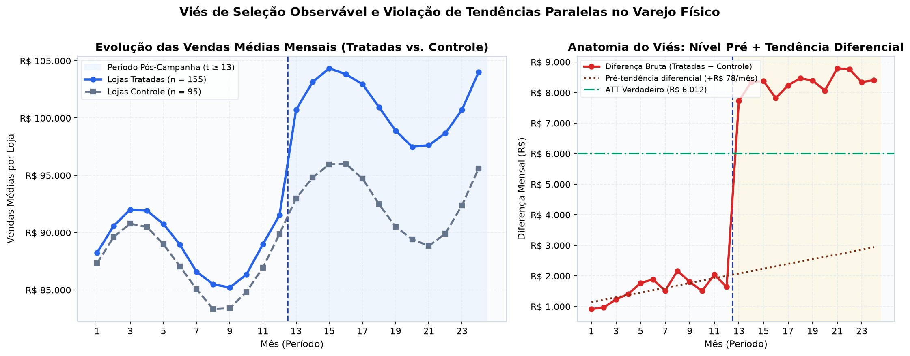
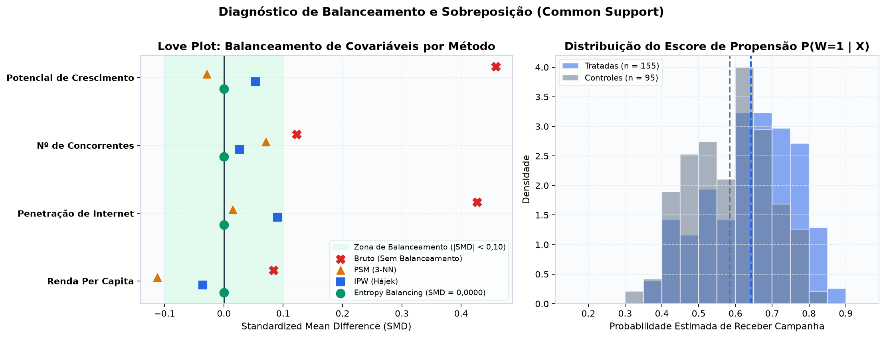
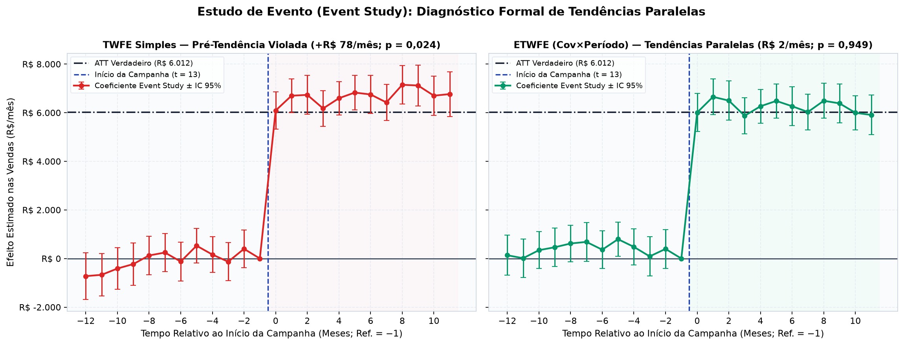
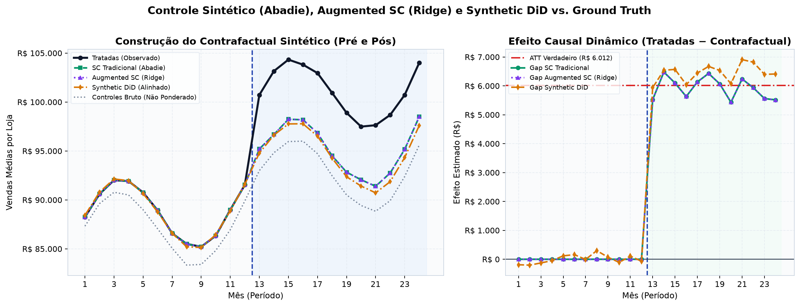
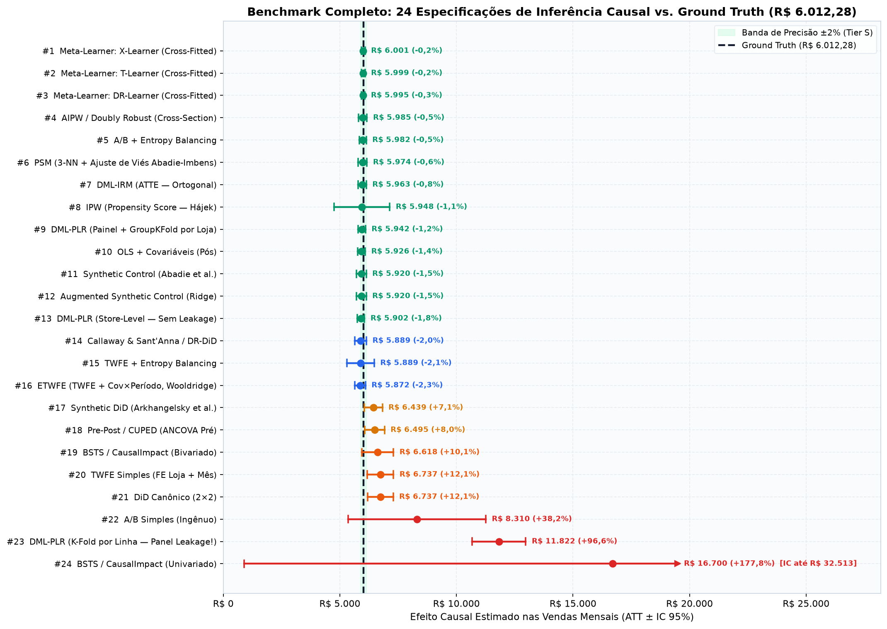
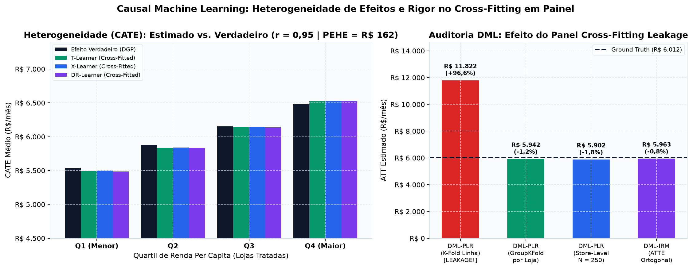

# 🎯 Inferência Causal em Marketing Digital sob Viés de Seleção e Tendências Não-Paralelas

<div align="center">


[](https://www.python.org/)
[](https://docs.doubleml.org/)
[](#como-executar)
[](.)

</div>

---

## 📌 Resumo Executivo

Este projeto investiga **como isolar o verdadeiro efeito causal (ATT)** de uma campanha de marketing digital sobre as vendas mensais de **250 lojas físicas** ao longo de **24 meses** (`6.000` observações em painel balanceado) quando a alocação da campanha **não foi aleatória** — violando tanto a independência entre tratamento e nível inicial quanto a hipótese clássica de tendências paralelas incondicionais.

Como conhecemos exatamente o Processo Gerador de Dados (DGP), com **efeito causal verdadeiro de R\$ 6.012,28/mês por loja tratada** (heterogêneo por renda e penetração digital), o estudo serve como um **laboratório empírico controlado** comparando **24 especificações reprodutíveis em Python** (`src/causal_benchmark.py` + `analise_causal_marketing.ipynb` / `.html`):

- **Cross-Section & Balanceamento:** A/B Ingênuo, OLS + Covariáveis, IPW (Hájek), PSM (3-NN + Ajuste de Viés Abadie-Imbens), AIPW / Doubly Robust, **Entropy Balancing (Hainmueller, 2012)** e Pre-Post / CUPED (ANCOVA).
- **Painel & Diferença-em-Diferenças:** DiD 2×2, TWFE Simples, TWFE + Entropy Balancing, **ETWFE de Wooldridge (2021)** (`Cov × Período` + $D \times (X - \bar X_1)$), **Callaway & Sant'Anna / DR-DiD (Sant'Anna & Zhao, 2020)** e **Event Study dinâmico**.
- **Controle Sintético & Séries Temporais:** *Synthetic Control* (Abadie et al.), *Augmented SC* (Ridge, Ben-Michael et al.), *Synthetic DiD* (Arkhangelsky et al.) e *BSTS / CausalImpact* (Univariado e Bivariado).
- **Causal Machine Learning:** *DoubleML* (`PLR` e `IRM`), **Auditoria de *Panel Cross-Fitting Leakage*** (`KFold` por linha vs. `GroupKFold` por loja) e *Meta-Learners* (`T`, `X`, `DR-Learner`) com validação de CATE contra o efeito individual verdadeiro.

> **Principais Achados:**
> 1. **A/B Ingênuo superestima o ROI em +38,2%** (`R$ 8.310,23` vs. `R$ 6.012,28`) por confundir viés de seleção em nível (`+R$ 1.572,92/mês` já antes da campanha) com efeito da mídia.
> 2. **DiD/TWFE canônico ainda erra em +12,1%** (`R$ 6.737,31`) devido à pré-tendência linear diferencial (`+R$ 78,13/mês`, $p = 0{,}024 < 0{,}05$).
> 3. **Armadilha silenciosa em Causal ML (Panel Cross-Fitting Leakage):** aplicar `DoubleML-PLR` com `KFold` padrão por linha sobre o painel pós-intervenção explode o viés para **+96,6%** (`R$ 11.822,25`); agrupar o *cross-fitting* por loja (`GroupKFold(loja_id)`) + controle sazonal derruba o erro para **-1,16%** (`R$ 5.942,45`)!
> 4. **Consenso entre famílias bem especificadas:** 13 estimadores distintos (Meta-Learners, AIPW, Entropy Balancing, PSM Abadie-Imbens, DML-IRM, IPW, DML-PLR com `GroupKFold`, OLS+Cov, Synthetic Control e ASCM) convergem para a banda **Tier S ($\le 2\%$ de erro)**, todos contendo o valor verdadeiro no IC 95%.

---

## 🧩 Anatomia do Problema e do Processo Gerador de Dados (DGP)

Uma rede varejista ativou campanhas digitais no **mês 13** em **155 lojas** (mantendo **95 controles**), priorizando mercados com maior renda, penetração de internet e público mais jovem:

| Dimensão | Especificação Exata no DGP (`data/dados_completos.csv`) | Implicação Econométrica |
| :--- | :--- | :--- |
| **Painel Balanceado** | `250` lojas × `24` meses = `6.000` observações (`155` tratadas em $t \ge 13$, `95` controles; `0` ausentes) | Permite comparar métodos *cross-section*, painel e contrafactuais sintéticos sobre a mesma base |
| **Seleção Observável** | $P(W_i = 1 \mid X_i) = \text{logit}^{-1}(0{,}5 + 0{,}8 \cdot \text{Potencial}_i)$ | Lojas tratadas já vendiam **+R\$ 1.572,92/mês** antes da campanha ($\text{SMD}_{\text{Potencial}} = 0{,}458$) |
| **Tendência Diferencial** | $\Delta_t Y_{it}(0) = 500 + 300 \cdot \text{Potencial}_i + 5000\sin\!\left(\frac{2\pi t}{12}\right)$ | Viola tendências paralelas incondicionais (+R\$ 78,13/mês no pré, $p = 0{,}024$) |
| **Efeito Heterogêneo (CATE)** | $\tau_i = 3000 + 2000 \cdot \text{Internet}_i + 1500 \cdot \frac{\text{Renda}_i}{3000}$ | **ATT Verdadeiro = R\$ 6.012,28/mês** ($\text{DP} = \text{R\$ } 447{,}96$; amplitude `R$ 4.892` a `R$ 7.003`) |

### Diagnóstico 1 — Trajetórias de Vendas e Pré-Tendência Diferencial



O painel esquerdo mostra a sazonalidade anual e o salto estrutural no mês 13; o painel direito isola a diferença bruta mês a mês (`Tratadas − Controle`), evidenciando que a brecha já crescia **+R\$ 78/mês antes mesmo da campanha começar**.

---

## ⚖️ Diagnóstico 2 — Balanceamento de Covariáveis (*Love Plot* & *Entropy Balancing*)

| Covariável | Média Tratadas | Média Controles (Bruto) | p-valor (Bruto) | SMD Bruto | SMD IPW | SMD PSM (3-NN) | **SMD Entropy Balancing** |
| :--- | ---: | ---: | ---: | ---: | ---: | ---: | ---: |
| `potencial_crescimento` | `0,0902` | `-0,1472` | `0,0005` | `+0,4581` | `+0,0533` | `-0,0290` | **`0,000000`** |
| `penetracao_internet` | `0,7452` | `0,6939` | `0,0010` | `+0,4270` | `+0,0902` | `+0,0146` | **`0,000000`** |
| `n_concorrentes` | `3,1032` | `2,8947` | `0,3494` | `+0,1223` | `+0,0262` | `+0,0709` | **`0,000000`** |
| `renda_per_capita` | `3.043,82` | `2.977,01` | `0,5273` | `+0,0833` | `-0,0357` | `-0,1124` | **`0,000000`** |



O **Entropy Balancing (Hainmueller, 2012)** resolve diretamente o problema dual convexo irrestrito encontrando pesos estritamente positivos sobre os controles que **zeram exatamente o SMD (`0,000000`)** em todas as covariáveis, superando a variância amostral do IPW e a discrepância residual do PSM sem descarte de observações — beneficiado pela excelente sobreposição de suporte comum ($0{,}30 \le \hat e(X) \le 0{,}88$).

---

## 📈 Diagnóstico 3 — *Event Study* e Teste Formal de Tendências Paralelas



- **TWFE Simples (esquerda):** o teste focalizado de pré-tendência linear ($t = 1 \dots 12$, clusterizado por `loja_id`) detecta inclinação diferencial de **+R\$ 78,13/mês ($p = 0{,}0235 < 0{,}05$)**; como consequência, os coeficientes pós-campanha sobem sistematicamente acima da linha tracejada de R\$ 6.012, produzindo viés de **+12,06%**.
- **ETWFE — Wooldridge (2021) (`Cov × Período` + $D \times (X - \bar X_1)$, direita):** a pré-tendência diferencial colapsa para **+R\$ 1,64/mês ($p = 0{,}9495$; Wald conjunto 11-gl $p = 0{,}3192$)**, e todos os coeficientes pós-campanha centralizam-se sobre o ATT verdadeiro (`R$ 5.872,46`, erro `-2,33%`, IC 95% contendo o valor verdadeiro).

---

## 🎛️ Diagnóstico 4 — Controle Sintético, Augmented SC e Synthetic DiD



A combinação convexa de lojas doadoras no simplex ($w_i \ge 0, \sum w_i = 1$) reproduz com precisão quase perfeita tanto o nível quanto a sazonalidade e a inclinação pré-campanha das tratadas, entregando **R\$ 5.920,18 (`-1,53%`)** no *Synthetic Control* (Abadie et al.) e no *Augmented SC* (Ben-Michael et al.).

---

## 🏆 Ranking Completo das 24 Especificações (Benchmark Python vs. Ground Truth = R\$ 6.012,28)



| Rank | Método | Categoria | ATT (R\$) | EP (R\$) | IC 95% | Viés (R\$) | Erro (%) | Contém ATT? | Tier |
| :---: | :--- | :--- | ---: | ---: | :---: | ---: | ---: | :---: | :--- |
| **1** | **Meta-Learner: X-Learner (Cross-Fitted)** | Causal ML | **6.001,17** | 39,35 | `[5.924; 6.078]` | -11,11 | **-0,18%** | ✅ | Tier S (≤ 2%) |
| **2** | **Meta-Learner: T-Learner (Cross-Fitted)** | Causal ML | **5.998,96** | 39,75 | `[5.921; 6.077]` | -13,32 | **-0,22%** | ✅ | Tier S (≤ 2%) |
| **3** | **Meta-Learner: DR-Learner (Cross-Fitted)** | Causal ML | **5.994,97** | 39,61 | `[5.917; 6.073]` | -17,31 | **-0,29%** | ✅ | Tier S (≤ 2%) |
| **4** | **AIPW / Doubly Robust (Cross-Section)** | Balanceamento | **5.985,40** | 91,77 | `[5.806; 6.165]` | -26,88 | **-0,45%** | ✅ | Tier S (≤ 2%) |
| **5** | **A/B + Entropy Balancing** | Balanceamento | **5.981,75** | 77,17 | `[5.831; 6.133]` | -30,53 | **-0,51%** | ✅ | Tier S (≤ 2%) |
| **6** | **PSM (3-NN + Ajuste de Viés Abadie-Imbens)** | Balanceamento | **5.973,66** | 96,24 | `[5.785; 6.162]` | -38,63 | **-0,64%** | ✅ | Tier S (≤ 2%) |
| **7** | **DML-IRM (ATTE — Ortogonal)** | Causal ML | **5.962,57** | 87,14 | `[5.792; 6.133]` | -49,71 | **-0,83%** | ✅ | Tier S (≤ 2%) |
| **8** | **IPW (Propensity Score — Hájek)** | Balanceamento | **5.947,50** | 607,93 | `[4.756; 7.139]` | -64,79 | **-1,08%** | ✅ | Tier S (≤ 2%) |
| **9** | **DML-PLR (Painel + GroupKFold por Loja)** | Causal ML | **5.942,45** | 79,79 | `[5.786; 6.099]` | -69,83 | **-1,16%** | ✅ | Tier S (≤ 2%) |
| **10** | **OLS + Covariáveis (Pós)** | Cross-Section | **5.925,74** | 82,69 | `[5.764; 6.088]` | -86,54 | **-1,44%** | ✅ | Tier S (≤ 2%) |
| **11** | **Synthetic Control (Abadie et al.)** | Controle Sintético | **5.920,18** | 107,38 | `[5.710; 6.131]` | -92,10 | **-1,53%** | ✅ | Tier S (≤ 2%) |
| **12** | **Augmented Synthetic Control (Ridge)** | Controle Sintético | **5.920,18** | 107,39 | `[5.710; 6.131]` | -92,10 | **-1,53%** | ✅ | Tier S (≤ 2%) |
| **13** | **DML-PLR (Store-Level — Sem Leakage)** | Causal ML | **5.902,43** | 77,95 | `[5.750; 6.055]` | -109,85 | **-1,83%** | ✅ | Tier S (≤ 2%) |
| 14 | Callaway & Sant'Anna / DR-DiD | Diff-in-Diff | 5.889,18 | 127,58 | `[5.639; 6.139]` | -123,11 | -2,05% | ✅ | Tier A (2–5%) |
| 15 | TWFE + Entropy Balancing | Diff-in-Diff | 5.888,69 | 298,74 | `[5.303; 6.474]` | -123,59 | -2,06% | ✅ | Tier A (2–5%) |
| 16 | ETWFE (TWFE + Cov×Período, Wooldridge) | Diff-in-Diff | 5.872,46 | 114,73 | `[5.648; 6.097]` | -139,82 | -2,33% | ✅ | Tier A (2–5%) |
| 17 | Synthetic DiD (Arkhangelsky et al.) | Controle Sintético | 6.438,71 | 196,86 | `[6.053; 6.825]` | +426,43 | +7,09% | ❌ | Tier B (5–10%) |
| 18 | Pre-Post / CUPED (ANCOVA Pré) | Cross-Section | 6.494,94 | 213,78 | `[6.076; 6.914]` | +482,66 | +8,03% | ❌ | Tier B (5–10%) |
| 19 | BSTS / CausalImpact (Bivariado) | Séries Temporais | 6.618,19 | 347,30 | `[5.937; 7.299]` | +605,90 | +10,08% | ✅ | Tier C (10–20%) |
| 20 | TWFE Simples (FE Loja + Mês) | Diff-in-Diff | 6.737,31 | 286,55 | `[6.176; 7.299]` | +725,03 | +12,06% | ❌ | Tier C (10–20%) |
| 21 | DiD Canônico (2×2) | Diff-in-Diff | 6.737,31 | 280,03 | `[6.188; 7.286]` | +725,03 | +12,06% | ❌ | Tier C (10–20%) |
| 22 | ❌ A/B Simples (Ingênuo) | Cross-Section | 8.310,23 | 1.504,82 | `[5.361; 11.260]` | +2.297,95 | **+38,22%** | ✅ | Tier F (> 20%) |
| 23 | ❌ DML-PLR (K-Fold por Linha — *Panel Leakage!*) | Causal ML (Anti-Padrão) | 11.822,25 | 587,43 | `[10.671; 12.974]` | +5.809,97 | **+96,63%** | ❌ | Tier F (> 20%) |
| 24 | ❌ BSTS / CausalImpact (Univariado) | Séries Temporais | 16.699,53 | 8.068,02 | `[886; 32.513]` | +10.687,25 | **+177,76%** | ✅ | Tier F (> 20%) |

---

## 🤖 Causal ML: Heterogeneidade (CATE) e Auditoria de *Panel Cross-Fitting Leakage*



1. **Recuperação da Heterogeneidade (Painel Esquerdo):** o efeito verdadeiro cresce de ~`R$ 5.540/mês` no quartil inferior de renda para ~`R$ 6.480/mês` no quartil superior. Os Meta-Learners com *cross-fitting* por loja recuperam fielmente o gradiente individual com **correlação $r(\hat\tau_i, \tau_i) = 0{,}95$** e **PEHE = R\$ 162/mês** (apenas 2,7% do ATT).
2. **Auditoria de *Panel Cross-Fitting Leakage* (Painel Direito):** em painéis onde $X_i$ é constante ao longo dos 12 meses pós-campanha, aplicar `DoubleMLPLR` com `KFold` padrão por **linha** coloca a mesma loja simultaneamente no treino e na validação do *cross-fitting*. Um aprendiz flexível de propensão (`RandomForest`) memoriza o tratamento $W_i$ de cada loja a partir da assinatura exata de $X_i$, colapsando o denominador ortogonal $V = W - \hat m(X) \approx 0$ e explodindo a estimativa para **R\$ 11.822 (+96,6%)**. Ao agrupar o particionamento por loja (`GroupKFold(loja_id)`) com dummies mensais e erro-padrão clusterizado na função de escore ortogonal $\psi$, o erro cai imediatamente para **-1,2%** (`R$ 5.942`).

---

## 📁 Estrutura do Projeto

```text
marketing-digital-vies-selecao-causalidade/
├── README.md                                       # Documentação completa do estudo
├── requirements.txt                                # Dependências Python do benchmark
├── .gitignore                                      # Regras de higiene (cache, temporários)
├── analise_causal_marketing.ipynb                  # Notebook Python executado (24 especificações)
├── analise_causal_marketing.html                   # Relatório HTML standalone (Python)
├── data/
│   ├── dados_completos.csv                         # Painel balanceado (6.000 obs = 250 lojas × 24 meses)
│   └── dados_pos.csv                               # Recorte pós-intervenção (3.000 obs = meses 13–24)
├── src/
│   ├── __init__.py
│   ├── causal_benchmark.py                         # Motor econométrico e Causal ML (24 especificações)
│   └── generate_visuals.py                         # Gerador das 6 figuras de qualidade de publicação
├── tests/
│   ├── __init__.py
│   └── test_causal_benchmark.py                    # 6 testes automatizados (integridade, SMD, DiD, DML)
└── img/
    ├── capa.png                                    # Capa visual do projeto
    ├── 01_trajetorias_vies_selecao.png             # Trajetórias + anatomia do viés
    ├── 02_love_plot_entropy_balancing.png          # Love Plot (SMD) + Common Support
    ├── 03_event_study_parallel_trends.png          # Event Study: TWFE Simples vs. ETWFE
    ├── 04_synthetic_control_sdid.png               # SC (Abadie), Augmented SC e Synthetic DiD
    ├── 05_ranking_completo_metodos.png             # Forest Plot completo (24 especificações)
    └── 06_cate_heterogeneidade_dml_leakage.png     # CATE por quartil + Auditoria Panel Leakage
```

---

## 🚀 Como Executar

### 1. Instalar Dependências Python
```bash
pip install -r requirements.txt
```

### 2. Executar o Benchmark Completo e Gerar as 6 Figuras
```bash
python -m src.causal_benchmark
python -m src.generate_visuals
```

### 3. Rodar a Suíte de Testes Automatizados (`6/6` testes, `0` warnings)
```bash
python -W default -m unittest discover -s tests -v
```

### 4. Reexecutar o Notebook Python e Exportar HTML
```bash
jupyter nbconvert --to notebook --execute --inplace analise_causal_marketing.ipynb
jupyter nbconvert --to html analise_causal_marketing.ipynb
```

---

## 📚 Referências Seminais

1. **Hainmueller, J. (2012).** *Entropy Balancing for Causal Effects: A Multivariate Reweighting Method to Produce Balanced Samples in Observational Studies.* Political Analysis.
2. **Abadie, A., Diamond, A., & Hainmueller, J. (2010).** *Synthetic Control Methods for Comparative Case Studies.* JASA.
3. **Abadie, A., & Imbens, G. W. (2011).** *Bias-Corrected Matching Estimators for Average Treatment Effects.* JBES.
4. **Ben-Michael, E., Feller, A., & Rothstein, J. (2021).** *The Augmented Synthetic Control Method.* JASA.
5. **Arkhangelsky, D., Athey, S., Hirshberg, D. A., Imbens, G. W., & Wager, S. (2021).** *Synthetic Difference-in-Differences.* AER.
6. **Sant'Anna, P. H. C., & Zhao, J. (2020).** *Doubly Robust Difference-in-Differences Estimators.* Journal of Econometrics.
7. **Callaway, B., & Sant'Anna, P. H. C. (2021).** *Difference-in-Differences with Multiple Time Periods.* Journal of Econometrics.
8. **Wooldridge, J. M. (2021).** *Two-Way Fixed Effects, the Two-Way Mundlak Regression, and Difference-in-Differences Estimators.*
9. **Chernozhukov, V., et al. (2018).** *Double/Debiased Machine Learning for Treatment and Structural Parameters.* The Econometrics Journal.
10. **Künzel, S. R., Sekhon, J. S., Bickel, P. J., & Yu, B. (2019).** *Metalearners for Estimating Heterogeneous Treatment Effects using Machine Learning.* PNAS.
11. **Wager, S., & Athey, S. (2018).** *Estimation and Inference of Heterogeneous Treatment Effects using Random Forests.* JASA.

---

## 👨‍🎓 Autor

**Dr. Silvio da Rosa Paula** — Doutor em Economia Aplicada (UFPel) & Cientista de Dados

[](https://www.linkedin.com/in/silvio-paula/)
[](https://github.com/silviopaula)
[](https://silviopaula.github.io/)
