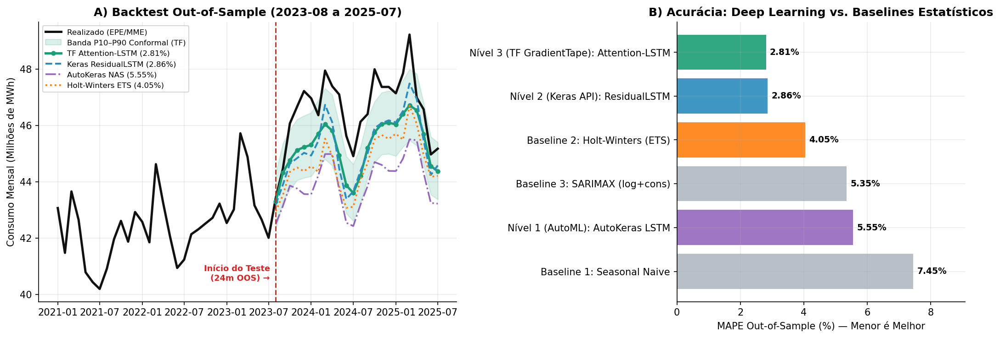
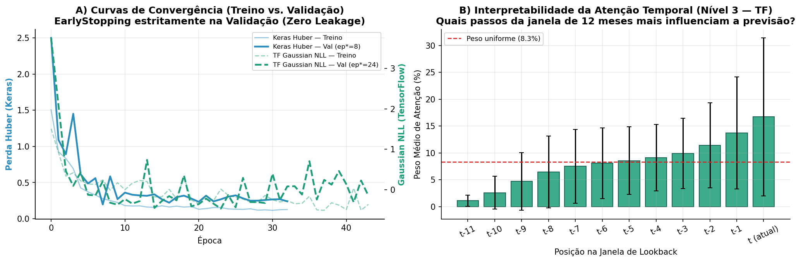
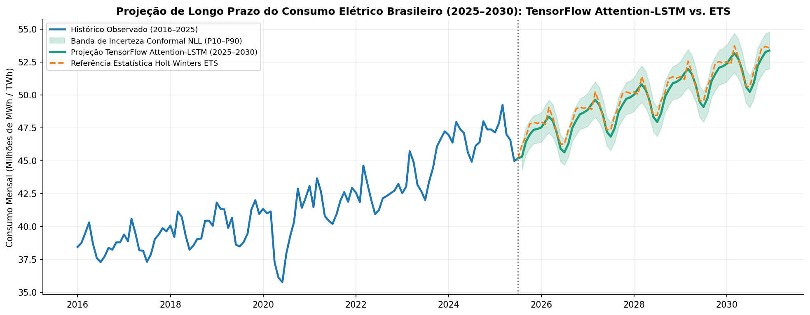

# ⚡ Previsão de Consumo de Energia com LSTM: Jornada Vertical (AutoKeras → Keras → TensorFlow)

<div align="center">


</div>

Exercício vertical completo de **Deep Learning para Séries Temporais**, percorrendo **três níveis reais de abstração** — **AutoKeras (AutoML/NAS)** → **Keras Functional API** → **TensorFlow de baixo nível (`tf.GradientTape` + subclasse probabilística `tf.keras.Model`)** — e comparando-os sob protocolo rigoroso ***zero data leakage*** contra **três *baselines* estatísticos clássicos** (**Seasonal Naive**, **Holt-Winters ETS** e **SARIMAX**) na previsão mensal do **Consumo de Energia Elétrica no Brasil (`2004–2025`, projeção `2025–2030`)**.

---

## 🎯 Diferenciais Metodológicos

1. **Estacionarização Física Anti-Saturação (`MWh / Consumidor`)**: o consumo elétrico brasileiro quase dobrou entre 2004 e 2025 (`27 → 45 TWh/mês`), o que satura redes LSTM comuns na extrapolação até 2030. Modelar $\ln(\text{Consumo}_t / \text{Consumidores}_t)$ (estável entre `0,42` e `0,55 MWh/consumidor`) com `StandardScaler` e multiplicar de volta por $\text{Consumidores}_t$ garante projeções fisicamente coerentes até 2030.
2. **Split Temporal Rigoroso em 3 Partições (*Zero Data Leakage*)**:
   - **Treino**: `2004-01` a `2021-07` (`211` meses)
   - **Validação**: `2021-08` a `2023-07` (`24` meses — exclusiva para NAS, *EarlyStopping* e calibração conformal $q_{80}$)
   - **Teste *Out-of-Sample* intocado**: `2023-08` a `2025-07` (**`24` meses completos**, mantendo o contexto histórico sem descartar os 12 primeiros meses do teste!)
3. **Nível 3 Genuinamente em TensorFlow de Baixo Nível**:
   - Subclasse `ProbResidualAttentionLSTM(tf.keras.Model)` com **Atenção Temporal Aditiva** (interpretável sobre a janela de 12 meses) + **conexão residual linear**.
   - Loop manual `@tf.function` + `tf.GradientTape`, **perda Gaussiana NLL heterocedástica** ($\hat{\mu}_t, \hat{\sigma}_t$), regularização L2, *Gradient Clipping* e **bandas P10–P90 calibradas via *Split Conformal Prediction***.
4. **Compatibilidade moderna**: inclui *shim* de serialização do `AutoKeras 2.0` para `Keras >= 3.11`.

---

## 📊 Resultados Verificados (Teste *Out-of-Sample* de 24 Meses: `2023-08` a `2025-07`)

| Ranking | Modelo | MAE (MWh) | RMSE (MWh) | MAPE (%) | Parâmetros |
| :---: | :--- | :---: | :---: | :---: | :---: |
| 🥇 | **Nível 3 (TF `GradientTape`): `ProbResidualAttentionLSTM`** | **`1.320.104`** | **`1.467.956`** | **`2,81%`** | `13.572` |
| 🥈 | **Nível 2 (Keras Functional API): `ResidualLSTM`** | `1.336.824` | `1.478.753` | **`2,86%`** | `12.347` |
| 🥉 | **Baseline 2: Holt-Winters (ETS)** | `1.897.349` | `2.019.986` | `4,05%` | `~16` |
| 4 | **Baseline 3: SARIMAX (`log + consumidores`)** | `2.499.094` | `2.591.802` | `5,35%` | `5` |
| 5 | **Nível 1 (AutoML): AutoKeras Bidirectional LSTM** | `2.598.667` | `2.696.269` | `5,55%` | `3.403` |
| 6 | **Baseline 1: Seasonal Naive ($y_{t-12}$)** | `3.480.885` | `3.622.349` | `7,45%` | `0` |

> **Progressão vertical comprovada nos dados:** sair do AutoML genérico (`5,55%`) para uma arquitetura enxuta com conexão residual no Keras (`2,86%`) e, finalmente, para o modelo probabilístico com Atenção Temporal + NLL Gaussiana no TensorFlow (`2,81%`) reduziu o erro em **`-49,4%` vs. AutoKeras**, **`-30,6%` vs. Holt-Winters ETS** e **`-62,3%` vs. Seasonal Naive**.



---

### 🔍 Interpretabilidade (Atenção Temporal) & Projeção 2025–2030

A camada de **Atenção Temporal** aprendeu um decaimento exponencial suave concentrando os maiores pesos nos passos mais recentes (**`t (atual)` ~17%, `t-1` ~14%, `t-2` ~11%**) enquanto preserva memória do ciclo de 12 meses; reajustado em 100% do histórico (`259` meses), o modelo projeta expansão consistente do consumo elétrico brasileiro de **`569,6 TWh` em 2026** até **`626,4 TWh` em 2030** (alinhado ao *sanity-check* estatístico Holt-Winters ETS).





---

## 📁 Estrutura do Projeto

```text
previsao-energia-deep-learning-lstm/
├── data/
│   └── dados.xlsx                                  # Base mensal 2004–2030 (Consumo MWh + Consumidores)
├── img/
│   ├── eda_consumo_intensidade_energia.png         # Consumo total, consumidores e intensidade (MWh/cons)
│   ├── comparacao_teste_24m_modelos.png            # Benchmark OOS 24m (3 níveis DL vs. 3 baselines)
│   ├── curvas_treino_atencao_tf.png                # Convergência Huber/NLL + Pesos de Atenção Temporal
│   └── projecao_energia_2025_2030_mc_dropout.png   # Projeção 2025–2030 (P10–P90) vs. Holt-Winters ETS
├── outputs/
│   └── projecao_energia_lstm_2030.csv              # Projeção mensal 2025–2030 (MWh + P10/P50/P90 + ETS)
├── lstm_vertical_keras_tensorflow.ipynb            # Notebook completo executável (AutoKeras -> Keras -> TF)
├── lstm_vertical_keras_tensorflow.html             # Relatório HTML pronto para leitura no navegador
├── requirements.txt                                # Dependências Python enxutas
└── README.md
```

---

## 🚀 Como Reproduzir

```bash
cd previsao-energia-deep-learning-lstm
pip install -r requirements.txt
jupyter lab lstm_vertical_keras_tensorflow.ipynb
```

Para leitura imediata sem executar código, abra [`lstm_vertical_keras_tensorflow.html`](./lstm_vertical_keras_tensorflow.html) diretamente no navegador.

---

## 👨‍💻 Autor

**Silvio da Rosa Paula** — Doutor em Economia Aplicada | Cientista de Dados  
[LinkedIn](https://www.linkedin.com/in/silvio-paula/) • [Portfólio Web](https://silviopaula.github.io/)
