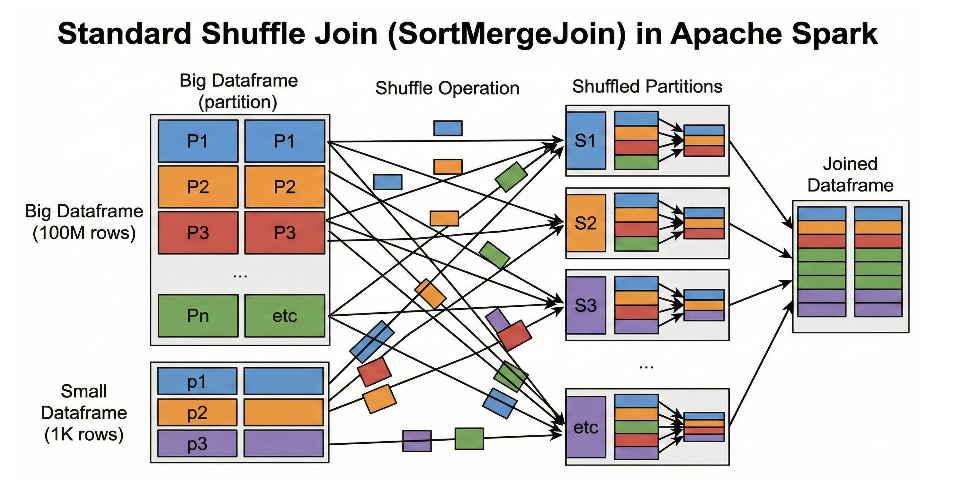
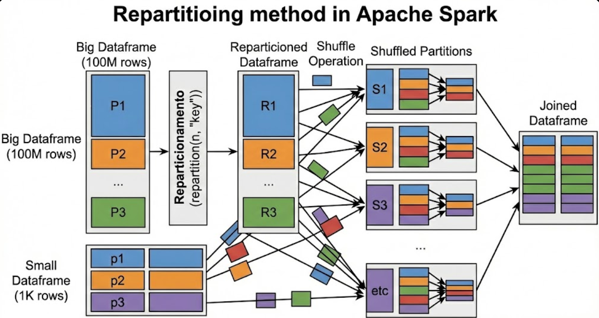
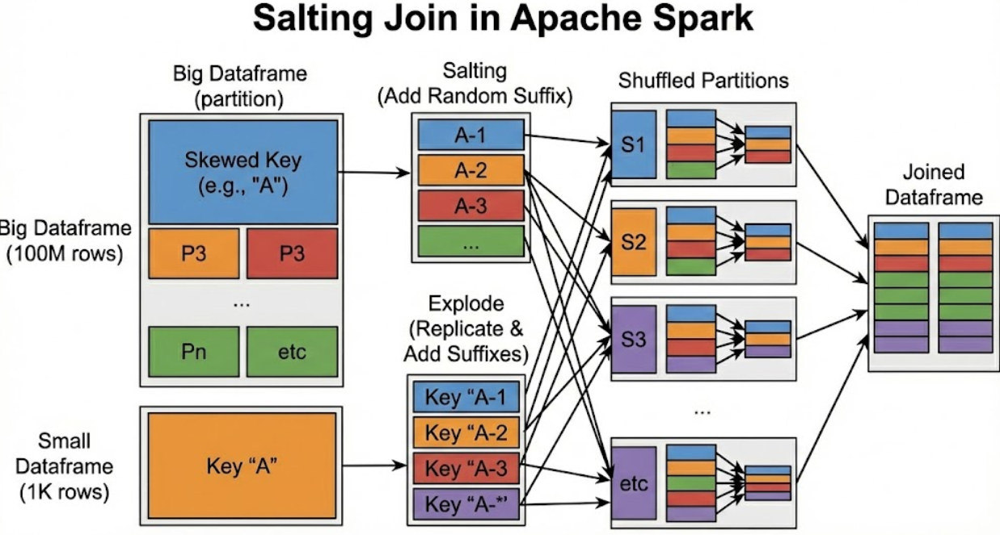
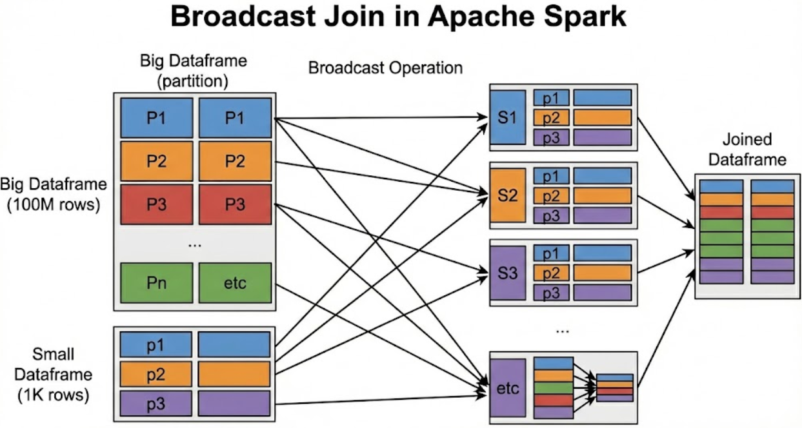

# ⚡ Otimização de Joins Desbalanceados (*Data Skew*) no Apache Spark

<div align="center">


**Benchmark prático em PySpark comparando 5 estratégias de Join diante de *Data Skew* severo (95% dos dados em uma única chave): SortMergeJoin, Repartition, Salting Manual, AQE Skew Join e Broadcast Hash Join**

</div>

---

## 📋 Sumário

- [Sobre o Projeto](#-sobre-o-projeto)
- [O Problema: Shuffle e Data Skew](#-o-problema-shuffle-e-data-skew)
- [As 5 Estratégias Comparadas](#-as-5-estratégias-comparadas)
- [Resultados do Benchmark Real (15 Milhões de Linhas)](#-resultados-do-benchmark-real-15-milhões-de-linhas)
- [Matriz Executiva de Decisão](#-matriz-executiva-de-decisão)
- [Estrutura do Projeto](#-estrutura-do-projeto)
- [Como Executar](#-como-executar)
- [Autor](#-autor)

---

## 🎯 Sobre o Projeto

Um dos maiores gargalos em pipelines de Big Data com **Apache Spark** ocorre quando realizamos **joins com chaves altamente desbalanceadas (*Data Skew*)** — por exemplo, uma grande rede de varejo onde 1 loja ("Mega Store") concentra 95% de todas as transações.

Neste projeto, traduzimos os conceitos de execução distribuída do Spark de forma didática (do Pandas ao Big Data) e conduzimos um **benchmark real em PySpark 4.0.1** sobre **15 milhões de transações** (`14.248.530` registros concentrados em `join_key = 1`), inspecionando inclusive os **Planos Físicos do otimizador Catalyst (`explain`)** e medindo o tempo puro de processamento com o sink `noop`.

---

## ⚠️ O Problema: *Shuffle* e *Data Skew*

No **Apache Spark**, para cruzar duas tabelas distribuídas, registros com a mesma chave precisam ser enviados para a mesma partição (**Shuffle / `Exchange`**). Quando uma chave concentra 95% dos registros:
- **1 único núcleo/executor** recebe quase toda a tabela e fica travado processando (efeito ***Straggler***);
- Todos os outros núcleos terminam em milissegundos e ficam ociosos esperando o núcleo mais lento finalizar o *Stage*.

<p align="center">
  
</p>

---

## 🛠️ As 5 Estratégias Comparadas

1. **Join Padrão (`SortMergeJoin` com Skew)**: Comportamento base sem broadcast e sem AQE, sofrendo integralmente com o *Shuffle* e o *Straggler*.
2. **Reparticionamento por Chave (`repartition(24, "join_key")`) — *A Armadilha***: Demonstra empiricamente por que reparticionar pela chave de join **não resolve skew de chave** (o *hash* coloca todos os `join_key = 1` juntos na mesma partição novamente).
   <p align="center"></p>
3. **Salting Join Manual (`K = 24`)**: Adiciona sufixos aleatórios (`0..23`) na chave da tabela fato e replica (`explode`) a dimensão 24 vezes, quebrando a chave gigante em 24 fatias balanceadas processadas em paralelo.
   <p align="center"></p>
4. **AQE — *Adaptive Query Execution* (`skewJoin.enabled = true`)**: Recurso nativo do Spark 3.x/4.x que monitora o tamanho real das partições pós-shuffle e subdivide automaticamente partições inchadas sem código manual.
5. **Broadcast Hash Join (`broadcast(df_small)`)**: Copia a tabela pequena (`1.000` linhas) para todos os executores, realizando o join localmente com **ZERO Shuffle** na tabela de 15 milhões de linhas.
   <p align="center"></p>

---

## 📈 Resultados do Benchmark Real (15 Milhões de Linhas)

Ambiente de execução: **Apache Spark 4.0.1** (`local[*]`, 12 núcleos de CPU), tabela fato com **15.000.000 de linhas** (`14.248.530` na chave `1`, ~95% skew) × tabela dimensão com **1.000 chaves**, usando `.write.format("noop")` para medir processamento puro sem escrita em disco.

| Posição | Estratégia de Join | Plano Físico Principal | Tempo (s) | Speedup vs. Padrão | Redução de Tempo |
| :---: | :--- | :--- | :---: | :---: | :---: |
| 🥇 | **5. Broadcast Hash Join** | `BroadcastHashJoin` (Zero Shuffle na Fato) | **`0,41 s`** | **`20,76x`** | **`-95,2%`** |
| 🥈 | **4. AQE Skew Join (Automático)** | `AdaptiveSparkPlan` + `SortMergeJoin` | **`2,93 s`** | **`2,90x`** | **`-65,6%`** |
| 🥉 | **3. Salting Join (Manual, K=24)** | `SortMergeJoin` (Chave particionada em 24x) | **`3,80 s`** | **`2,24x`** | **`-55,3%`** |
| 4º | **2. Repartition por Chave (Armadilha)** | `SortMergeJoin` + `Exchange` (Mantém Skew) | `7,01 s` | `1,21x` | `-17,6%` |
| 5º | **1. Join Padrão (SortMerge c/ Skew)** | `SortMergeJoin` + `Exchange` (Baseline) | `8,51 s` | `1,00x` | `0,0%` |

### Principais Aprendizados
- **Broadcast é imbatível** quando uma tabela cabe na memória: **20,7x mais rápido** que o Join Padrão.
- **AQE Skew Join (Spark 3/4) superou até o Salting Manual** (`2,93s` vs. `3,80s`), pois elimina o gargalo do *Straggler* sem pagar o *overhead* de CPU de gerar números aleatórios, concatenar strings e explodir a dimensão.
- **Repartition por chave é mito para *Key Skew***: só serve para desbalanceamento físico de arquivos (*File Skew*), não para chaves concentradas.

---

## 🧭 Matriz Executiva de Decisão

| Estratégia | Quando Usar? | Quando Evitar? |
| :--- | :--- | :--- |
| **Broadcast Hash Join** | Sempre que uma das tabelas couber confortavelmente na RAM dos executores (`< 100 MB` a poucos GBs) | Quando ambas as tabelas são grandes (risco de *Out of Memory*) |
| **AQE Skew Join** | **Ativado por padrão em produção** no Spark 3.x/4.x para joins entre duas tabelas grandes | Versões legadas do Spark (`< 3.0`) |
| **Salting Manual** | Ambas as tabelas são grandes, há **Data Skew extremo** e o AQE não resolveu (ex.: pipelines complexos) | Quando cabe Broadcast, sem skew, ou em hardware com poucas vCPUs (ex.: 2 cores) |
| **SortMergeJoin Padrão** | Ambas as tabelas são grandes e as chaves são bem distribuídas | Quando existe chave dominante (*Data Skew*) |
| **Reparticionamento** | Corrigir *File Skew* (muitos arquivos pequenos ou leitura desbalanceada) | Para tentar resolver *Key Skew* antes do join |

---

## 📁 Estrutura do Projeto

```text
spark-performance-big-data-joins/
├── img/
│   ├── img_default.png             # Diagrama do Join Padrão com Data Skew
│   ├── img_broadcast.png           # Diagrama do Broadcast Hash Join
│   ├── img_repartio.png            # Diagrama do Reparticionamento
│   └── img_salting.png             # Diagrama da técnica de Salting
├── otimizacao_joins_spark.ipynb    # Notebook PySpark executado com benchmark e gráfico
├── otimizacao_joins_spark.html     # Versão renderizada em HTML para leitura rápida
├── requirements.txt                # Dependências Python / PySpark
└── README.md                       # Documentação executiva do projeto
```

---

## 🚀 Como Executar

1. **Pré-requisitos**: Python 3.10+ e **Java JDK 17** instalado (`JAVA_HOME` configurado).
2. **Acesse a pasta e instale as dependências:**
   ```bash
   cd spark-performance-big-data-joins
   pip install -r requirements.txt
   ```
3. **Abra e execute o notebook:**
   ```bash
   jupyter notebook otimizacao_joins_spark.ipynb
   ```

---

## 👤 Autor

**Silvio da Rosa Paula**  
*Doutor em Economia Aplicada (UFPel) | Especialista em Inteligência Artificial e Ciência de Dados*

[](https://www.linkedin.com/in/silvio-paula/)
[](https://github.com/silviopaula)
[](mailto:silvio.rosa.paula@gmail.com)
